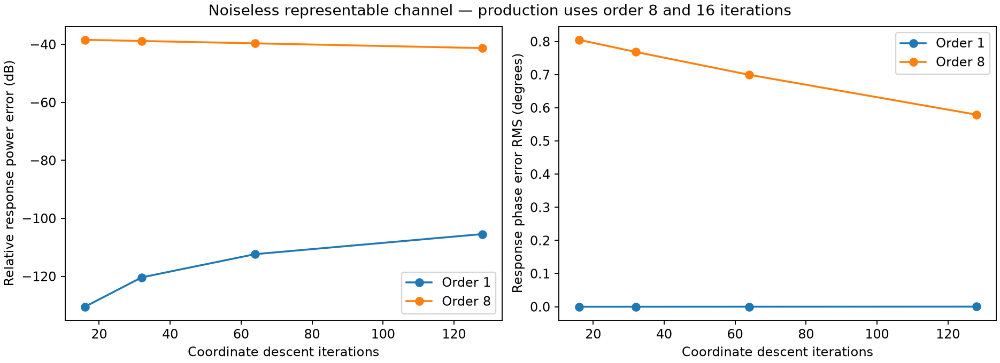
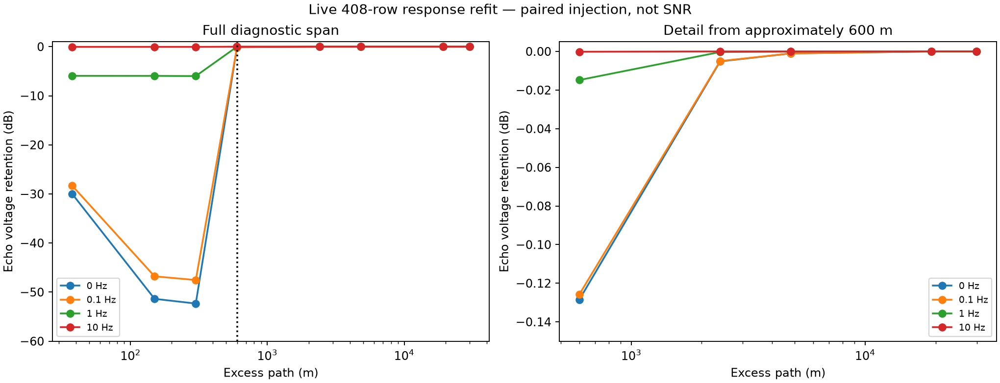
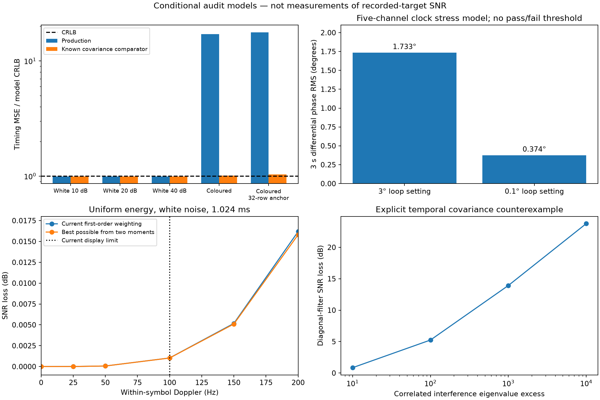

# Production pipeline: information preservation and cancellation review

Date: 2026-10-11. Scope: the current UHD/recorded-IQ production path, with five
VHF channels, a shared receive clock, a three-second detection aperture and
±100 Hz Doppler. This reviews the observations retained for subsequent SAR/ISAR,
not the appearance of a rendered map.

Follow-up: [receiver validation and implemented fixes](receiver_validation_20261011.md)
supersedes the solver, source-clock and pilot-weighting implementation findings
below. This document retains the original audit and its statistical limitations.

**The numerical channeliser/retimer is well supported by the tests. The complete
pipeline is not yet demonstrated to preserve all relevant information or attain
the appropriate nuisance-aware SNR/CRLB bound.** The most consequential findings
are in response estimation, cancellation, covariance modelling and the archive
boundary. Pursuing a smaller fraction of a degree is not the priority.

This review adds reproducible diagnostics and strengthens the actual 61.44 MS/s
resampling regression. It does **not** change production DSP, enable another
normaliser, change capture defaults, or claim a new measured sensitivity gain.
The existing 34 regression tests pass. Numerical agreement with a reference
implementation and statistical optimality are separate questions.

## Findings that determine the next work

| Finding | Current evidence | Consequence |
| --- | --- | --- |
| The response solver leaves avoidable direct-path error even with a noiseless, exactly representable channel. | Live-size 408-row GPU fit: order eight, 16 iterations leaves **−38.4 dB** relative response power error and **0.805° RMS** response phase error. At 128 iterations the power error is still **−41.3 dB**. | Fix the solve and establish an appropriate complex likelihood before relying on deep cancellation. Raising the iteration count is inefficient. |
| Minimum phase does not identify hardware separately from the scene. | `1 + a z^-d`, with `|a| < 1`, is itself minimum phase, despite containing a delayed echo. The paired GPU injections demonstrate absorption at short delay. | Protect the echo model explicitly; a minimum-phase constraint alone is insufficient. |
| Diagonal carrier variance is a useful approximation, not a general optimum. | A known temporal-covariance counterexample has **5.25 dB** of avoidable SNR loss while every time sample has the same noise variance. | No universal remaining-loss ceiling of 1–2 dB follows from the existing diagonal-noise tests. |
| Common receive timing does not make independent transmitter clocks identical. | The receiver advances windows by a fixed nominal symbol length, exports scalar phase/CFO, and sets the source origin once per acquisition segment. | A residual per-transmitter waveform time map is needed if transmitter rates differ appreciably. Preserve the common receive grid. |
| Compact profiles commit to upstream estimates and a restricted template family. | They retain two complex moments, cropped delays and coefficients, but not received spectra, reconstructed symbols or their full covariance/Gram operator. | They support the existing focusing model; they are not a demonstrated sufficient statistic for arbitrary later re-estimation/autofocus. |
| Existing numerical retiming and two-moment compression are not the main problem. | **0.00395°** maximum differential phase error at 61.44 MS/s in the known-trajectory regression; approximately **0.00103 dB** moment loss at 100 Hz in the white-noise model. | Keep the efficient shared architecture and two moments for the present Doppler range. |



The response error above is a controlled synthetic result, not a measurement of
the complete recorded-data cancellation ratio. A frozen stationary predictor
can cancel a stable response-fitting error. That does not establish correctness
when the response changes, or remove the need to propagate estimation error.

## The criterion for an irreversible operation

Use a declared observation model, including the quantities that are not known:

```text
y = μ(θ, β) + n
θ: target amplitudes, delay, Doppler and eventually trajectory/scattering parameters
β: direct path, hardware response, clock, source phase and other nuisance parameters
n: proper complex Gaussian noise with covariance R, for this benchmark model
```

For fixed, known, parameter-independent `R`, with real parameters and derivative
matrix `D`, the Fisher matrix is `J = 2 Re(Dᴴ R⁻¹ D)`. An independently fixed
linear compression `z = L y` gives

```text
Jz = 2 Re[Dᴴ Lᴴ (L R Lᴴ)† L D]  ≤  J.
```

Equality requires the relevant whitened derivative directions to lie in the
retained subspace. Eliminate nuisance parameters with the Fisher-matrix Schur
complement before comparing target CRLBs. A smaller output, a reversible phase
label or an accurately implemented FFT does not establish this equality.
Compression's effect on Fisher information is treated explicitly by
[Pakrooh et al., Analysis of Fisher Information and the Cramér–Rao Bound after Compressed Sensing](https://arxiv.org/abs/1504.01081).

For a *fixed linear scene model* `μ = S α` and known `R`, the matched scores
`Sᴴ R⁻¹ y`, together with the known Gram matrix `Sᴴ R⁻¹ S`, retain the likelihood
for `α`. This is the useful justification for range compression. For nonlinear
trajectory models, local score compression preserves Fisher information at the
specified expansion point; it is not a global guarantee for arbitrary later
trajectories. See
[Alsing and Wandelt, Generalized massive optimal data compression](https://arxiv.org/html/1712.00012v1).

The independent calculation in this audit verifies the matrix criterion on a
64-observation, three-parameter Gaussian problem: score compression retains
all three Fisher eigenvalues to floating-point precision. An arbitrary crop
retains 0.132, 0.173 and 0.269. Those crop numbers are a demonstration, **not an
estimate of this pipeline's delay-crop loss**.

For a known echo `s`, filter `w` and known noise covariance, use the actual
noise-normalised efficiency

```text
η = |wᴴ s|² / [(wᴴ R w) (sᴴ R⁻¹ s)].
```

If `R`, the response, clock or template is fitted from the same observations,
treating its fitted value as exact creates an optimistic conditional bound.
Detection SNR, estimator variance, coherent phase error, echo voltage retention
and direct-path suppression are different metrics; their dB values cannot
simply be added.

## Stage-by-stage review

| Stage / implementation | Execution | What happens to information | Assessment |
| --- | --- | --- | --- |
| [UHD receive](../src/uhd_capture.cpp), [continuity tracking](../src/live_input.cpp) | CPU | Receives sc16; uses applied rate/tuning, device timestamps and gap metadata. | Conversion cannot recover ADC clipping, analogue intermodulation or upstream sample loss. Absence of UHD drops alone does not prove a clean analogue input. |
| [I/Q unpack](../shaders/live_unpack.comp) | GPU | Integer samples are scaled by an exactly representable power of two into float32. | This conversion itself is exact for int16 samples. |
| [Channel bank](../src/gpu_frontend.cpp), [spectral retiming](../src/spectral_clock.cpp) | GPU, CPU scheduling | Shared FFT, symmetric prototype, affine common-clock mapping, channel IFFTs, residual interpolation, absolute NCO. Outside-band samples are discarded. | Strong numerical evidence. Retention is conditional on the desired signals occupying the kept bands and leakage meeting a specified output test. |
| [Receiver and pilot timing](../src/gpu_receiver.cpp), [shared clock](../src/sample_clock.cpp) | GPU reductions/FFT; CPU estimation | Estimates phase, frequency, symbol position and common receive-time warp. | Known-trajectory application is accurate. Estimated-trajectory uncertainty is not generally CRLB-tight; see the interference test below. |
| [OFDM windows](../shaders/ofdm_window.comp), [carrier extraction/equalisation](../shaders/ofdm_equalize.comp) | GPU | Keeps 8192 samples per symbol and 6817 occupied FFT bins. Equalised values feed the decoder; scientific `Y` stays un-equalised. | The separation of decoder and measurement paths is correct. Guard-time observations and unused bins are genuinely discarded. |
| [FEC](../src/cpu_fec.cpp), [frame scheduling](../src/frame_decoder.cpp), reconstruction | CPU hard FEC; GPU reconstruction | Successful packets regenerate the source; unknown reference cells/rows remain marked. | Appropriate strong-direct-path tradeoff. A passed RS word plus sync check is not an independent payload CRC guarantee against every miscorrection. No need to revive BCJR for this review. |
| [Response fit and subtraction](../src/gpu_response.cpp) | GPU; one-time CPU origin control | Fits a minimum-phase transfer after retiming and subtracts its prediction. | Convergence and statistical-model weaknesses demonstrated below. A fixed direct-origin coordinate is exported separately from the response. |
| [Stationary predictor](../src/stationary_background.cpp) | CPU sufficient-statistic accumulation | Learns a per-carrier complex transfer for at least three seconds, then freezes it. | Explicit removal of stationary scene content, not merely hardware compensation. Training uncertainty and scene contamination matter. |
| [Carrier noise](../src/gpu_noise.cpp), [variance shader](../shaders/noise_variance.comp) | GPU | Previous-batch scalar variance per carrier drives current weights. | Justified under the stated independent-innovation model. Does not represent general time/carrier correlations. |
| [Matched profiles](../src/matched_profiles.cpp), [finite-window correction](../shaders/matched_extract.comp) | GPU | Finite reference correlation, two time moments, limited excess delays. | Good small-Doppler approximation. Full statistical sufficiency and normalisation for a later scene model remain unproved. |
| [Constant-path-rate focus](../src/gpu_focus.cpp) | GPU; CPU control | Weighted coherent integration, stationary projection, range migration shear, Doppler interpolation. | Useful specified detection operator, with independent numerical checks. Does not solve unknown acceleration/ISAR trajectories. |
| [Live archive](../src/live_archive.cpp) | CPU asynchronous I/O | Saves channel IQ or already compressed complex profiles with provenance. | The choice determines which future estimates can be revised. Profiles are not raw likelihood data. |
| Preview pooling, colour mapping, video | Support tools | Takes power and spatial maxima for display. | Intentionally irreversible; remains outside the scientific signal path. |

### Channelisation, retiming and coherence

The frontend uses one receive-time trajectory for every channel, with continuous
published segments and recorded coordinates. Filter/NCO delay bookkeeping is
explicit; there is no per-channel receive resampling that silently changes the
inter-channel time reference. A symmetric FIR is evaluated with its delay removed
from the coordinates, rather than forward/backward filtering.

The strengthened regression includes the B200's **61.44 MS/s** source rate,
five VHF frequencies, a late recording epoch and clock-segment/chunk boundaries:

| Known-trajectory numerical check | Result |
| --- | ---: |
| Maximum complex error, 61.44 MS/s | 1.48 × 10⁻⁶ |
| Chunk-boundary difference | 1.45 × 10⁻⁷ |
| Maximum inter-channel phase error | 0.00395° |
| Swept full-scale blocker, clocked frontend | Worst measured leakage −105.67 dBFS |
| Float32 FIR prototypes, dense frequency grid, decimations 1–8 | Stopbands below −106.03 dB; passband amplitude error below 4.99 × 10⁻⁶ |

These tests supply the correct time trajectory. They do not measure how well the
receiver estimates it. The regression's analytic reference was also corrected
to avoid adding a small fraction to a large absolute floating-point epoch.
See [the complete numerical log](data/information_audit_20261011/spectral-clock.log).

The five-channel estimator stress model includes different transmitter rate
biases, slowly changing receiver drift, changing timing-noise levels and delayed
application of clock updates. It measures 1.733° RMS differential phase over
three seconds at the existing 3° loop setting, and **0.374°** at the diagnostic
0.1° setting. The latter is acceptable in scale for this project; it is not a
reason to keep tightening the loop. Neither setting is a certified worst-case
phase bound. This is a timing-observation model, not five complete independently
clocked DVB-T waveforms passed through live hardware. Production defaults were
not changed by the experiment.

Robustness work should test fading, lock loss/re-entry, clock-ensemble membership
changes, independent transmitter errors and estimator uncertainty. Keep a stable
ensemble reference; changes in measurement confidence must not redefine time.
Model each transmitter's residual waveform timing relative to that common grid.
The telemetry RMS fields are innovation/offset statistics, not calibrated CRLBs
or absolute timing-error measurements.

This last point is a separate model issue, not a demand for a smaller clock-loop
error: the receiver advances each channel's FFT windows by a fixed nominal
symbol length; the pipeline fixes the reference origin once per lock segment.
Per-symbol scalar phase/CFO is accounted for, but an independent transmitter's
residual time dilation is not fully incorporated into its reconstructed waveform.
A hypothetical 40 ppb transmitter-rate difference accumulates **0.32 channel
samples per second** against the ensemble grid. In the independent flat-spectrum
calculation, after one second even the best constant complex gain leaves about
−6.7 dB of relative direct-path error power. This is a model counterexample, not
a measured transmitter error or a prediction of the current recordings' quality.
It is why the final robustness test must include independently clocked *waveforms*,
rather than only the shared-clock observation test. Correct the oracle's time
coordinates if needed; do not independently warp the received channels.

The pilot likelihood was tested in 6,000 independent trials per case, with a
frequency-selective channel and an unknown complex gain. With independent white
noise its timing MSE/CRLB was 0.996 at nominal SNRs of 10, 20 and 40 dB, consistent
with unity within Monte Carlo uncertainty. When one fifth of the pilots had
20 dB more noise, that ratio became **17.04**. A diagnostic comparator supplied
with the true per-pilot variances gave **1.012**. A 32-symbol noisy anchor gave
17.69 versus 1.038. This demonstrates a robustness opportunity; **17× timing
variance is not a 12 dB loss of radar SNR**. It also does not establish that the
recordings have this particular impairment.

Decision-directed timing could condition on successfully reconstructed data as
well as continual pilots. In the flat known-channel calculation those carriers
contain 23.4× the single-symbol timing information. That is a conditional ceiling,
not a promised gain with unknown channel, decoder errors and transmitter drift.
Pursue this only if robustness testing warrants it, rather than optimising the
already acceptable fractional-degree example.

### Leakage relative to an ideal 12-bit ADC

The prototype mask is good, but the statement that leakage can *never* limit
sensitivity does not follow from an integrated quantisation-noise comparison.
For the explicit ideal, non-overloaded, independently dithered I/Q quantisation
model used here, full-scale complex-tone power is one:

| Noise integration bandwidth at 61.44 MS/s | Quantisation power |
| --- | ---: |
| Entire complex sampled band | −74.01 dBFS |
| 6.65625 MHz occupied channel | −83.66 dBFS |
| One 976.5625 Hz carrier-width bin | −122.00 dBFS |

A coherent blocker and white quantisation noise do not obtain the same
integration gain. A stopband maximum around −106 dB is not, by itself, a bound
on every long-CPI matched-filter cell. Conversely, the measured worst stopband
frequency need not alias into a retained target cell. Qualify leakage using
actual blocker frequencies, amplitudes and modulation through the *complete*
finite-window matched operator. Do not increase taps on the basis of this table
alone. The real ADC's correlated quantisation, clipping and nonlinear spurs are
outside the ideal quantisation model.

### OFDM observation selection and oracle validity

For guard 1/16, production retains an 8192-sample rectangular window from each
8704-sample symbol, starting 128 samples before the nominal useful-symbol start.
It then keeps 6817 carriers. The remaining observations are not mathematically
guaranteed irrelevant just because decoding does not require them.

With a known finite waveform and independent white noise at 8 MS/s, the
equal-energy guard-time duty loss is `10 log10(17/16) = 0.2633 dB`. An independent
OFDM simulation gives **0.260–0.261 dB** from selecting the windows. Additional
occupied-bin selection loss is at most **0.00105 dB** in the tested delays
0, 16 and 700 samples and Dopplers 0, 100 and 200 Hz. The long-delay calculation
uses adjacent actual symbols. These are conditional calculations: real
channel-filtered noise is correlated, so 0.2633 dB is not an exact measured
whole-pipeline loss. This small known tradeoff is less urgent than cancellation.

Oracle reconstruction reproduces the *coded ideal source*, not automatically
every feature of the emitted analogue waveform. A linear response can account
for linear transmitter/receiver filtering, but cannot in general represent
transmitter nonlinear distortion, changing phase noise or an incorrect decoded
packet. Reference validity is therefore part of the observation model. Erased
rows keep their timestamps and zero information; inventing samples or shortening
the nominal CPI around erasures would be wrong.

### Minimum-phase fit: convergence, model and echo retention

The production shader fits response **magnitudes**, using reference-energy
weights and coordinate updates to a real cepstral basis. It synthesises the
minimum-phase complex response and then estimates one constant phase. Live
processing uses order eight and 16 iterations on 408 rows, including decoder
context. This is not the general complex-Gaussian maximum-likelihood estimate
of the response.

The new convergence control generates
`H(k) = (0.7 + 0.4j) exp[(0.18 + 0.07j) exp(-jωk)]`, with noiseless known symbols.
The channel is exactly representable by either order one or order eight:

| Fitted order / iterations | Relative complex-response error power | RMS response phase error |
| --- | ---: | ---: |
| 1 / 16, diagnostic control | −130.5 dB | 0.000012° |
| **8 / 16, production setting** | **−38.4 dB** | **0.805°** |
| 8 / 32 | −38.8 dB | 0.768° |
| 8 / 64 | −39.6 dB | 0.700° |
| 8 / 128 | −41.3 dB | 0.579° |

This exposes incomplete convergence and the difference between fitting magnitude
closely and fitting the complex transfer closely. It is not an argument to force
order one on every real channel. The existing CPU/GPU agreement test uses the
same fixed-iteration objective on both sides and therefore cannot detect this
statistical/solver limitation. The new diagnostic compares with independent
known truth. More iterations also eventually accumulate float error in the easy
order-one control; iteration count is not a quality guarantee.

Even with a converged solve, magnitude-only fitting discards useful phase
measurements. A local, correctly specified order-one white-noise calculation
retains 0.394 and 0.606 of the two shape-parameter Fisher eigenvalues after
eliminating scalar gain/phase. Those correspond to **2.18–4.04 dB parameter-
variance penalties**, not that many dB of achievable target-SNR improvement.
Blindly fitting the complex transfer more freely would risk absorbing echoes;
the response and protected scene need a joint, identifiable model.

The paired echo test injects a −40 dB echo *before refitting*. It isolates the
fitted response's effect from its baseline numerical error. At approximately
600 m and DC, recovered echo voltage is 0.9853, or **−0.1285 dB**; at 1 Hz it is
0.9983, or −0.0148 dB. At 10 Hz it is essentially unity. Smaller delays can be
absorbed strongly. The user has already excluded the near-DC/short-delay region
from the sensitivity benchmark; this figure explains the mechanism without
making that region a new acceptance requirement.



This test uses the diagonal OFDM transfer model, including its long-delay rows.
It measures **voltage retention**, not output noise or finite beyond-guard
waveform accuracy. It does not justify subtracting the plotted dB directly from
an end-to-end SNR budget. Full-window waveform tests cover the latter operator
separately.

## Direct-path cancellation with the correct bound

For a declared linear nuisance model `A β` and candidate echo `α s`, whiten both
data and templates. With `z = R^-1/2 y`, `B = R^-1/2 A`, `g = R^-1/2 s`:

```text
P = I − B (Bᴴ B)† Bᴴ
T = |gᴴ P z|² / (gᴴ P g)
available echo SNR = |α|² gᴴ P g.
```

The matched-subspace construction projects the nuisance out of both data and
candidate template and uses the corresponding noise normalisation. Its
optimality depends on the declared Gaussian/subspace assumptions; it is not a
licence to fit arbitrary scene components as clutter.
[Scharf and Friedlander, Matched Subspace Detectors](https://api.mountainscholar.org/server/api/core/bitstreams/0bd25191-6792-419a-b526-2b4914839e17/content).

Compared with an unrealistically *known* direct-path amplitude, a single unknown
nuisance consumes the fraction `|ρ|²` of echo information, where `ρ` is the
normalised whitened template overlap. That loss is already present in the
correct unknown-nuisance bound. Minimising total residual power can consume
additional target information and is not the optimisation objective.

The current frozen predictor is a full per-carrier complex transfer. It can
remove stationary multipath as well as direct-path model error. It is trained
before publication, so the current CPI does not train its own stationary
predictor. However, previous data can still contain persistent targets; time
separation alone does not prove target-free training or independence.
If independent training gives nuisance-coefficient error covariance `Cβ`, the
subsequent residual covariance includes `A Cβ Aᴴ` under that model. Saving only
the fitted coefficients does not account for that uncertainty.

The additional weighted slow-time constant projection is justified as removal of
that declared component, with a corresponding loss near DC. Its combination
with range migration, frozen prediction and estimated covariance still needs a
joint projected-template/Gram test. Existing direct-backprojection comparisons
verify the implemented focusing operator; they do not independently prove that
the chosen nuisance model is optimal.

For reference, an [analytic nuisance-overlap plot](figures/information_audit_20261011/nuisance_information.png)
uses a flat 6.65625 MHz spectrum and a three-second rectangular aperture. It is
not a new measurement of the production minimum-phase fitter.

## Noise covariance, normalisation and window choice

The current variance shader uses source-conditioned weighted residual scatter
after estimating one constant complex transfer per carrier. Under independent
noise `D / |X|²` in the source-divided observations, division by `count − 1` is
justified. The previous batch supplies current weights. The `1e-30` protection
is numerical zero protection, not a fraction of a measured median or a
data-dependent noise-floor clip.

What remains unproved is the independent-innovation model itself. Tracking
errors, residual direct-path phase noise, finite-window coupling and interference
can correlate carriers and symbols. Persistent echoes can enter the secondary
variance estimate. The scalar profile `information` is proportional to
`Σ |Hk|² / Dk`; it is not the complete realised waveform Gram matrix or the
covariance of the two correlated moments and neighbouring delays.

The profile division by this scalar and the subsequent information weighting
cancel in the matched numerator. That bookkeeping is not the earlier empirical
map-flattening operation. However, exact reflectivity uncertainty and detection
normalisation still require the realised template and covariance.

An explicit three-second counterexample uses
`R = I + P b bᴴ`, a random complex coherent interferer at 12 Hz and a target at
12.4 Hz. All diagonal entries of `R` are identical. At `P = 100`, diagonal
weighting loses **5.25 dB** against the known-covariance optimum; at `P = 1000`,
the gap is 13.93 dB. This disproves an unconditional 1–2 dB remaining-gap claim.
It does **not** predict that these gains exist in the recordings or advocate
fitting a large covariance matrix to each target-bearing CPI.



For the first detector, retain the rectangular coherent aperture with physically
justified inverse-noise weights. In independent white noise, Hann loses about
1.76 dB of matched-filter SNR for a constant-amplitude tone. Its lower sidelobes
are a tradeoff, not a universal optimum. Direct-path sidelobes should first be
handled by a validated nuisance model. If a taper is useful against a remaining
specific interferer, measure that tradeoff against the same noise/nuisance bound.
Flattening the displayed background by multiplying final cells changes neither
their physical SNR nor the available information.

## Range compression and the archive boundary

The finite-waveform correlation correctly uses current and previous reconstructed
symbols to replace the circular prefix where an echo crosses the guard. This is
essential beyond the guard interval. The two retained moments approximate
within-symbol Doppler. In a uniform-energy, white-noise 1.024 ms window:

| Within-symbol Doppler | Current first-order matched-filter SNR loss | Best possible from the same two moments |
| --- | ---: | ---: |
| 50 Hz | 0.0000645 dB | 0.0000644 dB |
| **100 Hz** | **0.001028 dB** | **0.001022 dB** |
| 200 Hz | 0.01618 dB | 0.01580 dB |

Keep the two-moment representation at the current ±100 Hz. These numbers isolate
the approximation; they do not include coloured covariance, model fitting,
decoder erasures or later acceleration. Within-symbol frequency-estimation
Fisher information is a different quantity from integrated target SNR.

The 1024 stored delay slots contain lags **−64 through +928**; slots corresponding
to 929–959 are zero. Spacing is 37.474 m. The positive context is about 34.8 km,
with negative context for migration. Production checks that the requested
constant-path-rate excursion stays inside these margins. They are not a full
8192-lag correlation, and an arbitrary later trajectory cannot be assumed to
stay within them.

The live `PROF` archive retains the two complex moments, fitted response, applied
carrier variances, frozen predictor, validity, row epochs, CFO/phase correction
and common-clock trajectory. It does **not** retain `Y`, canonical source `X`,
the full template Gram operator or estimation-error covariance. It therefore
cannot generally support changing upstream whitening, response estimation,
retiming, omitted observations or intra-symbol template family. Some fixed
scene likelihoods can be compressed exactly into matched scores; that equality
has not been established for this archive and the intended future SAR model.

Available boundaries:

| Saved product | What can still be changed |
| --- | --- |
| Live `PROF` | Focus the retained profiles, change downstream display/CPI and compatible motion operators. Upstream information loss remains. |
| File-path `SPEC` / `SarBatch` | Retains un-equalised occupied `Y`, reconstructed `X`, validity and provenance; permits new cancellation/weighting/finite-window templates for those observations. CP and unused bins are already absent. |
| Live `CHIQ` (`--archive channels`) | Retains full channelised 8 MS/s complex streams before OFDM selection, response fitting and range compression. Acquisition/training data are included. Shared retiming and channelisation have already happened. |

For a bounded validation capture, `CHIQ` is the available safer boundary while
the compact representation is being qualified. Five cf32 channels cost about
**320 MB/s, or 19.2 GB/minute**, compared with about 75 MB/s for profiles; this
needs sustained writer-throughput validation. It is not raw wideband ADC IQ and
does not promise exact reversal of discarded bands or the original ADC warp.
No capture mode was changed silently during this review.

## Efficient, robust follow-through

1. **Fix and qualify the response/cancellation model first.** Use independent
   known-channel tests to enforce convergence, then a small, well-conditioned
   complex likelihood solve for the declared response/nuisance model. Preserve
   fixed delay/phase coordinates and test protected echoes during estimation.
   Do not replace 16 iterations with 128 or make the response unconstrained.
   Include per-transmitter source timing in the forward model whenever it differs
   from the common receive grid; a hardware-response fit must not substitute for it.
2. **Use a bounded upstream validation archive and evaluate the likelihood.**
   Compare raw channel observations with each successive transform using the
   same injected echo and nuisance parameters. Record matched-filter efficiency,
   target-parameter Fisher eigenvalues and nuisance-induced bias, not only
   cancellation depth or image contrast. Keep 0.6–30 km, ±100 Hz, three seconds,
   with the deliberately suppressed near-DC region excluded as already agreed.
3. **Add only covariance structure supported by independent tests.** Start with
   the existing diagonal model and explicit low-dimensional direct-path error
   modes. Structured temporal covariance is useful only if held-out tests show
   improved noise-normalised detection without target absorption. Any shrinkage
   or regularisation needs a specified statistical objective and uncertainty.
4. **Qualify the compact archive against the intended motion model.** Matched
   scores plus a reproducible template/Gram operator can be a sound efficient
   interface. Decoded source data can be stored compactly rather than duplicating
   every complex source carrier. Preserve enough observations until the required
   subspace/equality test passes; no blanket arbitrary-ISAR claim is needed.
5. **Keep the fast frontend and small-Doppler compression.** Clock work should
   target fades, interference and transitions with a stable ensemble reference,
   not a smaller nominal phase-error number. Recovering guard-time information
   is a lower-priority quantified tradeoff rather than the first optimisation.

These are remaining production changes, not gains already implemented by this
audit. Validation should use independent stochastic trials and disjoint training
for nuisance/covariance estimates, with SNR steps, coloured and coherent
interference, fades, source errors and hardware-model mismatch. Compare to both
the known-nuisance bound and the correct estimated/unknown-nuisance bound. Measure
CPU work, GPU timestamps and throughput separately when changing the solver or
covariance path. No processing-time claim is inferred from test-suite duration.

## Reproduction and scope of evidence

- [Diagnostics and commands](../support/validation/README.md#information-preservation-audit).
- [Estimator trials](data/information_audit_20261011/estimators.json),
  [independent calculations](data/information_audit_20261011/calculations.json),
  [paired response injections](data/information_audit_20261011/response-live.csv),
  [response convergence](data/information_audit_20261011/response-live.log).
- [Full regression log](data/information_audit_20261011/ctest.log): **34/34 passed**,
  13 CPU-labelled and 21 GPU-labelled tests, on Apple M5/MoltenVK. GPU-labelled
  tests include host orchestration; these labels are not performance accounting.
- [Strengthened spectral-clock regression](data/information_audit_20261011/spectral-clock.log).
- [Source hashes and model settings](data/information_audit_20261011/manifest.json).

No fresh RF capture, real-target ground-truth experiment, new hardware calibration
or complete five-independent-transmitter waveform robustness sweep was performed
for this review. The simulations establish specific numerical properties and
counterexamples to overbroad optimality claims. They do not certify all-loss
real-capture sensitivity.
