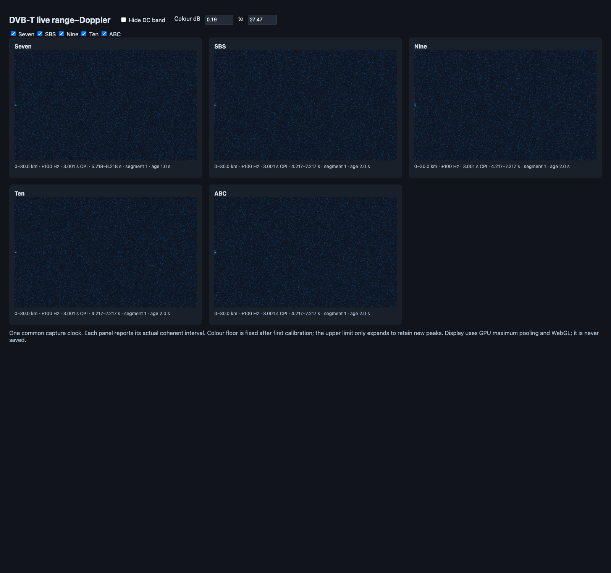

# Live capture validation — 11 October 2026

This report records the original ANSI/browser prototype. The interactive FTXUI
terminal and native ImPlot display now replace that UI; see the
[current UI validation report](live_tui_validation_20261011.md). Transport and
DSP measurements below remain historical evidence for the same live input path.

The direct UHD front end is built and validated with simulated input, as requested.
Five independent DVB-T channels ran together at 64 MS/s, with zero capture losses,
zero invalid RS evaluations, complex-profile archiving and a working GPU display.
The complete run measured **2.62× realtime processing headroom for all five channels
together**. Hardware reception remains unqualified: UHD discovery reported no
device, and the B200mini was deliberately excluded from this acceptance test.

Use the [capture guide](live_capture.md) and
[live metadata](../recordings/live_mt_dandenong.json) to run it. The executable is
`build/release/dvbt_capture`; simulation and display support are in `support/live`.

## Test input and scope

[`simulate_capture.cpp`](../support/live/simulate_capture.cpp) independently
encodes five random DVB-T streams, continuously modulates them, combines them on
the declared RF offsets, adds noise and quantises to signed int16. The fixture is
10.000896 seconds at 64 MS/s, with 8K, 64-QAM, code rate 3/4 and GI 1/16.
No radar echoes are injected, so the preview below shows the residual floor.
The raw fixture is a temporary support artifact; production acquisition saves no
wideband ADC I/Q.

The capture request specifies 61.44 MS/s; the replay source applies the WAV's
64 MS/s rate. The pipeline uses the applied value. A separate GPU regression
checks the 61.44-to-64 MS/s common-grid conversion. CPU archive tests check exact
preservation of a fractional applied rate, `61440000.047871`, and coerced gain,
bandwidth and master-clock values.

Simulation replaces UHD receive calls with paced or unpaced int16 reads into the
same mapped ring. It exercises ownership, GPU conversion/channelisation, shared
clock tracking, OFDM recovery, CPU FEC, reconstruction, response estimation,
range/Doppler processing, output queues and terminal/display code. It does not
qualify USB transport, UHD packet handling on a physical device, oscillator drift,
RF impairments, weak-signal acquisition or sustained thermal behaviour.

## Results

| Test | Result |
| --- | --- |
| Full Release regression | 30/30 tests pass, including 20 GPU tests |
| Paced five-channel capture, profiles and browser grid | 640,057,344 received samples; zero overflows, missing samples, host discards or unquantified gaps |
| DVB-T recovery in that run | Each channel: 8,976 emitted rows, 172,247 valid RS evaluations, zero invalid words, zero resets, three maps |
| Injected discontinuity, unpaced | Exactly 119,999 missing samples at 2.5 s; one overflow, one timestamp gap, no host discards or unquantified losses |
| Recovery after discontinuity | All five channels reacquired once; each emitted 8,704 rows with zero invalid RS evaluations |
| Real terminal and Ctrl-C | Alternate screen and cursor restored; clean exit; completed channel archive; no drops |
| Archive integrity | Reader validates every record's dimensions, EOF and `DONE`; CPU tests compare complex values, stationary/fitted responses and noise weights exactly |
| Live display | Five WebGL panels; channel selection and DC hiding pass; no JavaScript errors; renderer reports ANGLE Metal on Apple M5 |
| Optional `--profile` | A bounded 1.5 s run reports positive unpack/channeliser/receiver GPU timestamps, with zero drops and all five channels decoding |

RS counts include repeated decoding context; they are evaluated words rather than
unique transport packets. Emitted-row counts are unique. The simulation has strong,
clean signals, so its successful FEC results establish integration rather than a
new BER sensitivity result.

The discontinuity starts the next capture segment at ADC sample 160,119,999.
Archived profiles after reacquisition carry a new decoder segment and start at
6.659 s, after renewed stationary training. Neither detector histories nor
reference/FEC context bridge the missing samples. Decoder and capture segment
identifiers have distinct meanings and need not match numerically.

The Ctrl-C test received 128,712,704 samples before stopping, emitted 1,632 rows
per channel, and closed a 643.49 MB channel archive. Its TUI transcript includes
per-channel CFO, differential drift, pilot timing/RMS, phase RMS, pilot quality,
ADC drift estimates, clock-fit support, ensemble participation, TPS/FEC and queue
health. All channels were tracking when it exited.

### Phase and ownership regression

The live GPU input test uses five simultaneous tones at 61.44 MS/s, a common
5 ppm clock correction, an epoch beyond 2³⁴ samples, ring wraparound and a later
explicit coordinate discontinuity. Every output sample matches the existing
host-input channel-bank path **bit for bit**. An independent analytic NCO/clock
phase prediction gives a maximum error of **0.00001413°**, below the test's 0.02°
bound and the production 3° budget. This is a numerical bookkeeping check; it
does not claim that a real oscillator is known to that precision.

CPU tests also stress a bounded producer/consumer ring over 200,000 samples,
partial receives, overflow/sequence indications, host discards, unresolved losses,
backwards/missing timestamps, and long-capture coordinate arithmetic. A loss
without a quantifiable timestamp remains explicit; it is not converted into a
fabricated sample count.

## Throughput interpretation

| Configuration, five channels together | Processed input | Time in DSP path | Headroom |
| --- | ---: | ---: | ---: |
| Paced, complex profiles and GPU/browser grid | 10.0006 s | 3.8099 s | 2.62× |
| Unpaced, complex profiles, injected gap, no display | 9.9987 s | 3.1358 s | 3.19× |
| Unpaced, no archive or display | 10.0006 s | 2.8660 s | 3.49× |
| Paced, channel-I/Q archive, stopped with Ctrl-C | 2.0109 s | 0.8259 s | 2.43× |

Headroom divides processed input time by elapsed time inside the DSP path,
including gap drains and final decoder/detector/archive flushes. It excludes
receive waits and pre-stream compilation/warm-up. The capture thread and archive
writer run concurrently. These are single-run measurements; the configurations
also perform different work, so differences are not isolated component costs.
Zero discards during paced capture are the direct realtime acceptance evidence.

The browser run used five FEC workers. Their CPU-only work intervals sum to
7.0712 worker-seconds across the 10-second input; these overlapping wall durations
are not process CPU time or a utilisation percentage. They must not be added to
the elapsed DSP time. GPU timestamp queries were disabled in normal operation
and are `null` in these summaries; use `--profile` for device timings.

## Saved evidence and reproduction

The small evidence package is in [`data/live_capture_20261011`](data/live_capture_20261011):
[capture summary](data/live_capture_20261011/acceptance_summary.json),
[profile archive inventory](data/live_capture_20261011/acceptance_archive.json),
[gap results](data/live_capture_20261011/gap_summary.json),
[gap archive inventory](data/live_capture_20261011/gap_archive.json),
[TUI transcript](data/live_capture_20261011/shutdown_terminal.txt),
[phase log](data/live_capture_20261011/phase.log),
[browser results](data/live_capture_20261011/browser.json) and
[regression log](data/live_capture_20261011/ctest.log).
The [short profiled run](data/live_capture_20261011/profile_summary.json) also
records all applied SDR values when waveform archiving is disabled.

The live display is display-only in production. This screenshot was taken by the
support validation tool; the fixture contains no moving targets:



From the repository root, with the normal Vulkan environment:

```sh
cmake --build --preset release --target dvbt_capture simulate_capture -j 6
build/release/simulate_capture recordings/live_mt_dandenong.json \
  build/five_channels.wav 10
build/web-venv/bin/python support/live/validate_capture.py \
  --fixture build/five_channels.wav --output build/capture-acceptance \
  --browser '/Applications/Google Chrome.app/Contents/MacOS/Google Chrome'
python3 support/live/validate_capture.py --fixture build/five_channels.wav \
  --output build/capture-gap --gap-samples 119999 --unpaced
python3 support/live/validate_shutdown.py --fixture build/five_channels.wav \
  --output build/capture-shutdown
ctest --preset release --output-on-failure -j 2
```

All output paths must be new. The browser check uses Playwright in the existing
dedicated `build/web-venv`; the production capture executable and archive reader
have no browser/Python dependency.
