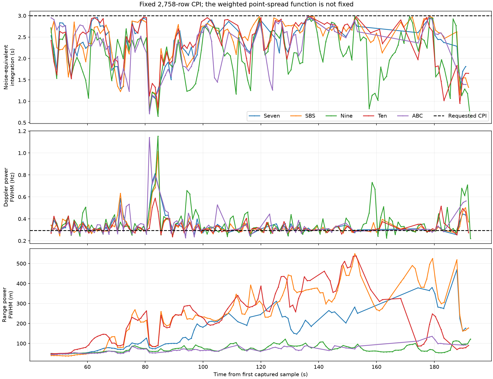
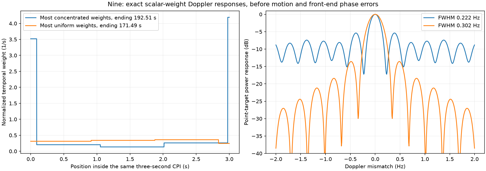
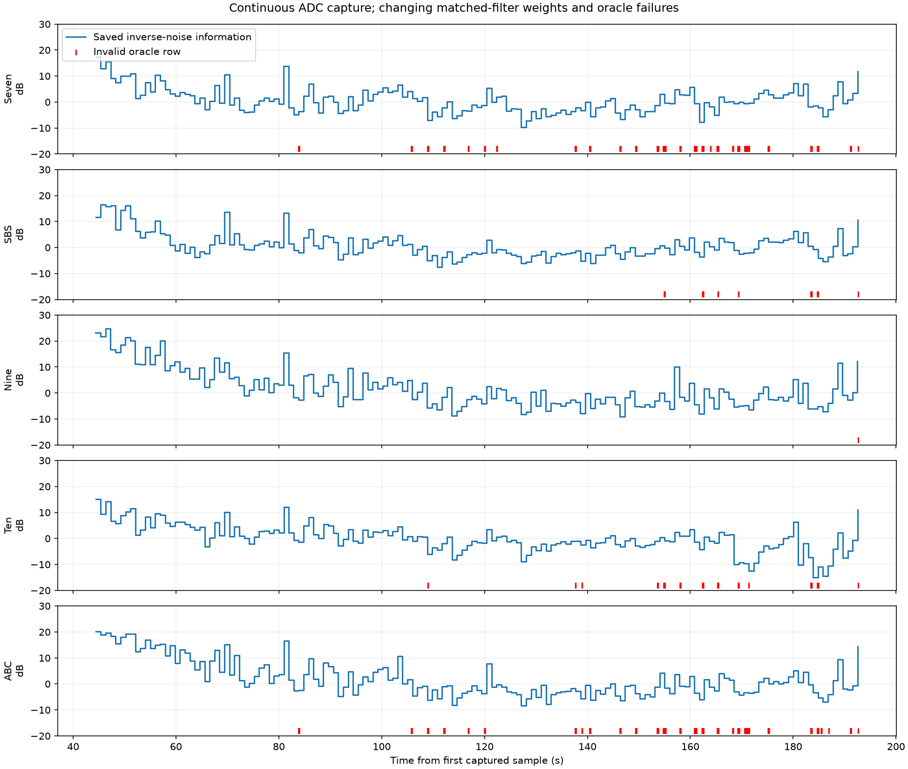

# Live-map variability and saved-capture replay, 11 October 2026

The changing blur is a property of the current weighted matched filter, even
though every complete map contains the same three-second observation interval.
This capture is from the **B200mini**, despite its directory being named
`captures/simulation-001`. It has no replay seams and no reported ADC sample loss.

The source is `captures/simulation-001/capture.dvblive`, an 11.33 GB completed
profile archive from approximately 192.69 seconds of reception. UHD reports
61,440,000.04787071 S/s, centre 201,999,999.99523142 Hz, gain 34 dB and antenna
TX/RX. Capture reports zero overflows, sequence errors, timestamp gaps, missing
samples and host discards. The archive has one transport segment and a DONE
record. It contains 136,272 saved profile rows per channel, from approximately
44.4 to 192.7 seconds, in one consecutive segment per channel. All timestamp
steps are 1.088 ms to floating-point precision.

## What is fixed, and what changes

The matched detector uses exactly **2,758 consecutive valid OFDM rows**. The
reported CPI is **3.000704 s** and the interval between the first and last row
starts is **2.999616 s**. This path does not call the older adaptive
`coherent_suffix()` selection. Invalid oracle rows clear the history instead
of creating a shorter or partially populated map.

However, the temporal window is `inverse_noise`, not rectangular. Every decoded
batch has an estimated information value

\[
 I_b = \frac{1}{8192}\sum_k \frac{|\hat H_{b,k}|^2}{\hat\sigma^2_{b,k}}.
\]

The profiles divide by this value; the focus applies weights proportional to it.
Those archived values vary sharply. In the one-second-spaced diagnostic sample,
the equivalent rectangular duration of the applied **window shape** reaches
as low as 0.597 s. At the full video cadence it reaches **0.351 s** on Nine:

\[
 T_{\rm equiv}=\Delta t\frac{(\sum_n I_n)^2}{\sum_n I_n^2}
              =1/\mathrm{ENBW}.
\]

This does **not** say the actual CPI became shorter, or establish an SNR loss.
With genuinely unequal noise, unequal weights can be the correct SNR-maximizing
choice. It does establish that the applied aperture and its Doppler response
change. The exact scalar-weight response is
`abs(sum(I[n] * exp(-i*2*pi*df*n*dt)))**2 / sum(I)**2`; this analysis evaluates it
independently of the GPU and UI.

The spectral weights also change. For a point target matching the implemented
template model, the expected range response is the Fourier transform of
`abs(H)**2 / variance`. The CPI response sums these carrier weights over its
actual constituent batches. It can become much narrower in frequency and much
broader in range. The table uses complete, valid three-second windows admitted
at approximately one-second spacing, **not counts of frames actually displayed**.

| Channel | Equivalent duration, min–max | Scalar Doppler power FWHM, min–max | Predicted CPI range power FWHM, min–max | Invalid saved rows |
| --- | ---: | ---: | ---: | ---: |
| Seven | 0.735–2.958 s | 0.246–0.813 Hz | 48.6–469.6 m | 1,386 |
| SBS | 0.729–2.989 s | 0.240–1.015 Hz | 37.5–549.4 m | 159 |
| Nine | 0.597–2.979 s | 0.222–1.154 Hz | 47.2–122.3 m | 1 |
| Ten | 0.863–2.979 s | 0.237–0.588 Hz | 49.1–537.8 m | 312 |
| ABC | 0.711–2.975 s | 0.227–1.141 Hz | 44.3–135.7 m | 1,389 |

A rectangular three-second window has a 0.295 Hz scalar power FWHM. These
one-dimensional responses describe aperture effects away from the deliberately
suppressed DC region. They are not a measured full two-dimensional echo PSF:
the production focus additionally includes finite-waveform moments and range
migration, and real targets can have motion and phase errors.





## Why updates can also pause

Zero transport drops does not imply that every reconstructed oracle row passes
FEC. A single invalid row prevents any CPI that contains it. For this capture,
Seven and ABC have appreciable gaps in complete-window availability despite
approximately 99% of their saved rows being valid. SBS and Nine have much better
availability. When no replacement map is ready, the native UI retains the old
image and its age increases. CPU FEC also releases decoded rows in approximately
0.96-second batches, and live focusing defaults to a one-second update interval.
These effects account for uneven publication cadence independently of drawing
the texture at a high frame rate.



Receiver reacquisitions and stationary training occurred before the first saved
profiles. The archive cannot reconstruct the initial approximately 44 seconds;
the first complete map is around 47.4 seconds. The video marks unavailable
intervals instead of filling them or carrying an old image indefinitely.

## What this confirms and what it cannot prove

The archived coefficients demonstrate a changing mathematical filter response
before rendering. A fixed row-count CPI alone does not ensure fixed visual
resolution. The capture is not failing because of the synthetic replay boundary
discussed previously. No production DSP settings were changed for these exports.

The archive cannot independently verify that the estimated noise covariance is
correct. It retains the already-whitened profiles, fitted response and applied
carrier variances; it does not retain the measured/reference carrier streams or
I/Q needed to re-estimate them. These results therefore do not distinguish true
interference changes from estimator error or residual timing/channel modelling
errors. Nor do they prove a sensitivity bound. Setting equal temporal weights
would stabilize part of the response but could lose SNR; replacing the existing
carrier whitening cannot be done exactly from the saved profiles alone.

## Videos and reproducible tooling

The exports are in
[`renders/live_b200mini_20261011_simulation-001`](../renders/live_b200mini_20261011_simulation-001):
one video each for Seven, SBS, Nine, Ten and ABC. They use the original complex
profiles and weights, the production Vulkan constant-velocity focus, frozen
stationary subtraction, three-second CPIs, ±100 Hz, 0–30 km and 3125/102 fps
(approximately 30.637 fps). Colour bounds are fixed for each whole video: median
displayed background minus 1.5 dB to the true maximum plus 0.25 dB. The output is
hardware ProRes in MOV with independent frames and a front-loaded index.

```sh
cmake --build --preset release --target live_profiles_preview -j 6
export VK_ICD_FILENAMES="$PWD/build/sdk/macOS/share/vulkan/icd.d/MoltenVK_icd.json"
build/web-venv/bin/python support/video/render_capture.py captures/simulation-001 \
  --output renders/another-export --integration 3 --doppler-hz 100
```

Replay and video tooling remain in `support/video`; diagnostics remain in
`support/live`. The replay never estimates or applies another clock or phase
correction. It preserves complex samples, both moments and the common corrected
time coordinates. The regression covers row/moment layout, phase preservation,
fixed CPI admission, cadence, invalid rows, timing gaps, segment changes and
archive truncation/completion. All fourteen Python video tests pass. The GPU
preview regression matches CPU calibrated peak power to within 0.00000346 dB.
Actual archive smoke replay produced twenty checked maps with the exact CPI,
physical RF and time-span coordinates.

Numerical evidence is in [analysis.json](data/live_map_20261011/analysis.json),
[smoke-map checks](data/live_map_20261011/live-profiles-smoke-check.json) and the
adjacent regression logs. Full timing/weight arrays remain in
`build/live-map-analysis-final-20261011/timing_and_weights.npz`; video commands,
map timestamps and fixed scales are recorded beside each export.

All five exports completed with **5,904 frames each**, duration **192.70656 s**
(rounded up to a whole frame), fixed scales and zero upper clipping. Their
admitted map counts are Seven 2,555, SBS 3,954, Nine 4,451, Ten 3,539 and ABC 2,561.
Every exported map's end time matches an independent admission calculation
from the archived validity/timestamps. Every map has the same row count, CPI,
physical RF and phase-epoch formula. The final replay binary reproduces the
twenty-map smoke output byte-for-byte.

FFprobe confirms ProRes, 1920×1080, BT.709, the correct frame counts/rate, all
frames marked independently decodable and the MOV index before media data.
AVFoundation passed **170 exact-frame seeks**, including consecutive forward
and reverse frames. Median seek latency is approximately 5.7–5.9 ms per channel;
this validates the playback framework, not QuickTime Player UI automation.
Results are in [video_validation.json](data/live_map_20261011/video_validation.json).
