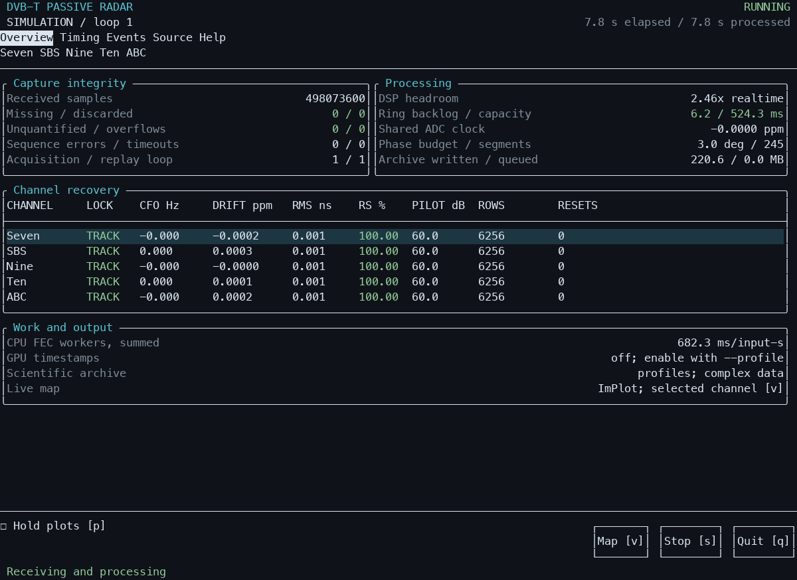
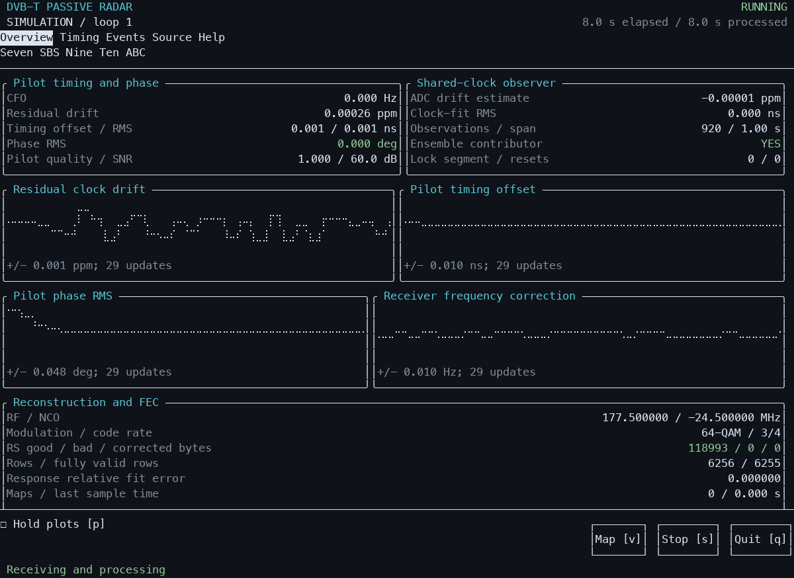
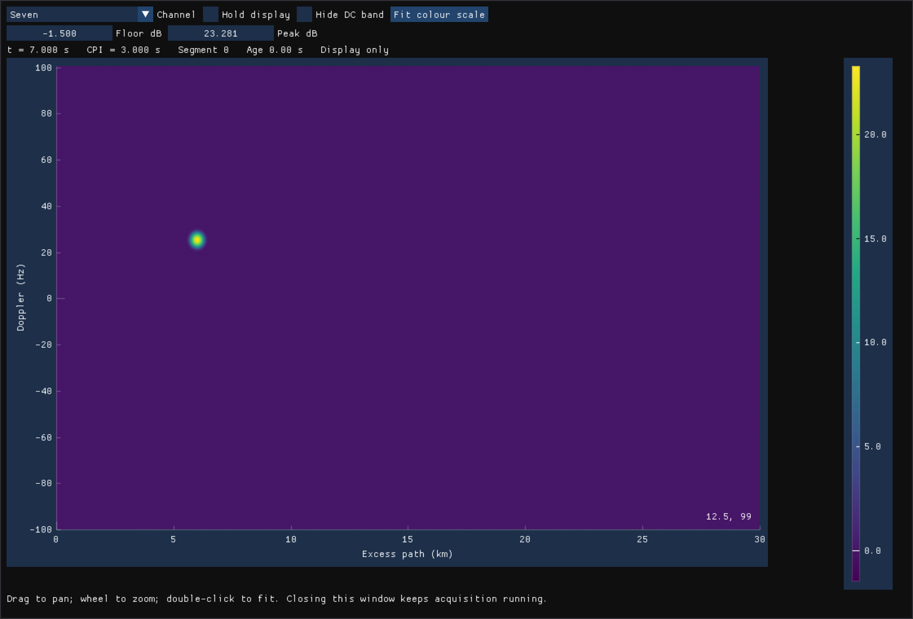

# Interactive capture UI validation — 11 October 2026

The capture front end now uses an actual FTXUI terminal application, modelled on
the RAD002A terminal controls. The TUI remains the primary interface. `v` opens
a native ImPlot window for the selected channel. The earlier live HTTP/WebGL
implementation and its command-line port option have been removed.

Open [the simulation launcher](../support/live/simulate.command), or follow the
[capture guide](live_capture.md). The existing five-channel int16 fixture is
10.000896 seconds long. Replay now loops by default until stopped. Its sample
epoch remains monotonic; every seam starts a fresh acquisition segment and
invalidates coherent history without falsely reporting dropped samples.

## Actual terminal validation

`support/live/validate_tui.py` launches the real executable in a 120×38
pseudo-terminal with stdin/stdout/stderr attached. It sends keyboard events,
responds to cursor-position queries, and renders terminal output through `pyte`.
The PNGs below are actual received terminal screens, not mock-ups. Braille dots
are drawn explicitly because Pillow lacks Terminal's font fallback.

The checks exercise Help, Source, channel selection, Timing, Events, resizing to
80×24, and both shutdown paths. `s` stops and drains while leaving results open;
`q` exits. Keyboard Ctrl-C also drains and exits. The original terminal flags,
speeds and control characters are restored, along with the alternate screen.
Darwin's transient `PENDIN` bit is excluded from the termios comparison because
the driver sets it when canonical input is restored.

The five-channel paced run with native map selection consumed 13.062 seconds of
input, continued across one file seam, and reported zero missing/discarded samples,
zero unquantified gaps, zero overflows and zero failed RS evaluations. All five
channels reacquired and stayed locked. Seven published one map and SBS two; the
three hidden channels published none. Measured processing headroom was **2.51×
realtime for all five channels combined**, including final drain. This is a
transport/UI acceptance measurement, not a new detailed CPU/GPU profile.

The separate Ctrl-C run archived complex profiles, crossed the seam, and finished
with one `DONE` record and two acquisition-gap records. Its archive queue drained.
Capture metadata still records requested and applied SDR settings.

## Native renderer and axis validation

ImPlot uses a Metal image texture fed by owned, GPU-pooled previews. UI rendering
and window management run on the main thread; the capture and Vulkan DSP pipeline
run on a worker. Hidden channels skip Doppler focusing and retain bounded range
history. All focus plans are warmed before capture. The display has pan/zoom,
channel selection, hold, colour limits and a display-only DC mask; there is no
background grid. Closing/reopening it changes subscriptions without stopping RX.

The independent `native_display_check` feeds the actual Vulkan preview projector
with known synthetic targets, renders real native windows, closes/reopens between
channels, and exports its own framebuffer. This export path runs only when the
support helper requests it; normal display performs no graphics readback.

Seven's target is near 6 km / +25 Hz; SBS's is near 10.5 km / −25 Hz.
`validate_native_images.py` locates their maxima within the exported ImPlot
rectangle and verifies range and signed-Doppler orientation. Maximum coordinate
error was below 0.08% of an axis span. This catches a double row reversal found
and corrected during visual checking; scientific complex samples were unaffected.

## Evidence and limits

All **32 CTest checks passed**: 12 CPU checks and 20 Vulkan checks, including
multi-channel phase bookkeeping, live ring continuity and the new replay/UI
regressions. Native window validation is separate from CTest so routine tests do
not open a GUI. Hardware reception is still untested in this acceptance run, as
requested; simulated input exercises the same ring/channeliser/decoder path.
The native viewer currently shows one selected channel at a time.

- [Five-channel native capture summary](data/live_tui_20261011/native_capture.json)
- [Ctrl-C capture summary](data/live_tui_20261011/shutdown_capture.json)
- [Completed profile archive](data/live_tui_20261011/shutdown_archive.json)
- [Terminal restoration evidence](data/live_tui_20261011/terminal_settings.json)
- [Native pixel-coordinate checks](data/live_tui_20261011/native_image_checks.json)
- [Full CTest log](data/live_tui_20261011/ctest.log)
- [Compact 80×24 terminal screenshot](figures/live_tui_20261011/compact.png)

Reproduction commands are in [support/live](../support/live/README.md).
