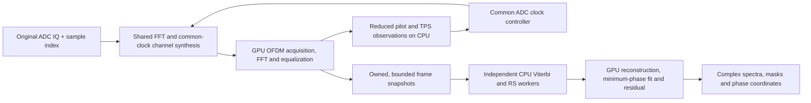

# Coherent pipeline scheduling and resident input — 6 October 2026

Common-clock correction now shares channel synthesis, and the remaining pipeline
can overlap CPU decoding with GPU reception. The resampling arithmetic and its
phase proof are described in [the resampling report](resampling_optimization_20261006.md).
This pass removes unnecessary waits, gives asynchronous work bounded ownership,
and exposes resident raw-IQ input. It preserves the complex scientific outputs.

The later [CPU/GPU profiling rerun](performance_breakdown_20261006.md) gives the
current granular component timings and checks the union of GPU timestamp spans.

The measured reduction in **incremental clock-correction cost** is 18–44×,
depending on channel count. Complete channelization improves approximately
1.7–2.0× in the earlier isolated GPU measurements: its filtering and transforms
remain real work. This is not a claim of 10× whole-frontend or whole-pipeline speedup.

## Dependency and ownership model



The necessary CPU feedback boundary remains after reduced OFDM observations.
Clock tracking does not depend on FEC completion. `GpuReceiver` returns typed
timing observations in channel coordinates; `receiver_clock.hpp` converts them
to the common ADC coordinates and updates the ensemble controller. The
demodulator has no channelizer, recording, or clock-controller dependency.

The forward FFT still serves all selected channels. Channel synthesis dispatches
workgroups across windows and channels. Ordinary affine clock windows apply
the midpoint delay in the spectrum and interpolate the remaining displacement
inside the existing channel-IFFT workgroup. There is no separate full-rate warp
or extra FFT round trip on this path. Windows crossing immutable clock segments,
and channels whose prototype transition crosses ADC Nyquist, retain the checked
full-band correction path. The common clock and centre-dependent NCO phase term
are identical for every channel; downstream applied carrier corrections remain
explicit in the handoff.

`gpu::Commands` groups GPU-only dependencies rather than waiting after each
kernel. History copy and OFDM analysis share a submission. Phase correction,
frame-ring maintenance and snapshot capture can be submitted without a CPU
carrier read. Reconstruction, response estimation and residual formation share
another group. The first fixed-origin calibration still requires one reduced
CPU read. The consumer runs after completion on the caller thread.

`FrameDecoder` owns a bounded pool of GPU frame snapshots. Each worker owns a
`CpuFec` instance, waits for its snapshot's readiness, and produces owned corrected
packets. Snapshot storage is released only after reconstruction and consumption.
There are no dropped frames or unbounded queues: when the pool fills, the caller
waits for a queued head. Default worker count is one per channel, capped by
hardware concurrency; default slot count is workers plus two. These counts are
configurable through `GpuPipelineConfig`.

Completion order is preserved **within each channel**. An unfinished batch on
one channel does not hold up a completed head on another. Independent frames
retain their decoder context; this does not assume that the DVB-T convolutional
code terminates at frame boundaries. Reference-origin state remains ordered per
channel/acquisition segment.

The command group owns a pooled fence; kernels retain a shared submission until
their descriptors, mapped uploads, or command buffers can safely be reused.
Workers wait for readiness without invoking timing callbacks. Query collection
stays on the owner thread, and pipeline timing storage outlives pending kernels.
Destruction joins workers before destroying snapshots or shared decoder tables,
including when a consumer throws.

The implementation uses one explicit Vulkan queue and memory dependencies
between compute writes, later compute accesses and host reads. It does not rely
on command submission order alone for visibility. The applicable primary
references are [Khronos compute synchronization examples](https://docs.vulkan.org/guide/latest/synchronization_examples.html)
and [the Vulkan synchronization specification](https://docs.vulkan.org/spec/latest/chapters/synchronization.html).

`ChannelBatch` describes borrowed device planes and their corrected-grid
coordinates. `Modem` contains DVB-T tables and encoding conventions; legacy
recording and visualization options live in `pipeline.hpp`. Neither frame
decoding nor the spectral core depends on video, map rendering or propagation
geometry. `SarBatch` adds declared physical RF and the common clock trajectory.

## Resident raw-IQ entry point

`GpuChannelBank::process_clocked_device(BufferView, valid_samples, input_start,
first_center, count, timings)` accepts already resident raw IQ. It executes the
same `SpectralClock` implementation as the host-span entry point. There is no
host waveform copy, mapping requirement, output readback, or additional FFT.

Attach the common clock first and allocate `input_capacity()` complex samples.
Supply actual original-ADC halo samples and zero padding after `valid_samples`.
The input must use the bank's Vulkan context; upstream GPU writes must be made
visible to compute reads on that queue. `gpu::Kernel::finish` supplies this
dependency. Keep the input storage alive until this synchronous call returns.
Its result is borrowed until the next bank call. `input_start` is an original
ADC index; `first_center` is on the corrected grid and aligned to the declared
channel origin. These coordinates must not be interchanged.

VkFFT detects replacement input buffers by pointer identity. The FFT plan now
uses two persistent launch-handle slots, alternating them to update descriptors
even when successive `BufferView` values use the same caller stack address.
The regression deliberately alternates two different resident waveforms through
that address, with `mapped=nullptr`, and compares every output bit with the
host-span implementation.

Paired resident/host-span frontend measurements use 200 measured iterations
after 20 warmup iterations, a 5 ppm common clock error, 56 MS/s input, and no
file I/O or waveform readback. Times are milliseconds per input second:

| Channels | Host-span elapsed | Resident elapsed | Host-span active CPU | Resident active CPU | Host-span GPU span | Resident GPU span |
| ---: | ---: | ---: | ---: | ---: | ---: | ---: |
| 1 | 28.36 | 22.88 | 8.91 | 1.84 | 13.42 | 14.34 |
| 5 | 41.68 | 35.97 | 11.62 | 4.96 | 23.61 | 24.57 |
| 7 | 47.36 | 42.94 | 14.49 | 8.05 | 26.46 | 28.54 |

This interface saves CPU copying and padding; it does not reduce the GPU
arithmetic. The recording adapter already reads into mapped input storage, so
these copy savings must not be added to its measured speedup. The resident
measurement exercises frontend throughput, not end-to-end decoding.

## End-to-end measurements

Apple M5, Release, MoltenVK, the first 60 seconds of the real C31 recording.
Five seconds of acquisition warmup are excluded; 54.97599762 input seconds
remain. The frozen comparison implementation already has the new spectral
resampler, but waits synchronously for FEC and each GPU numerical stage.

| Work | Owner | Frozen synchronous | Final scheduling |
| --- | --- | ---: | ---: |
| Compute elapsed, ms/input second | Wall clock | 127.83 | 69.35 |
| Channelization and common retiming | GPU timestamp span | 21.73 | 25.19 |
| OFDM reception | GPU timestamp span | 5.58 | 6.62 |
| Frame storage/copies | GPU timestamp span | 3.11 | 2.97 |
| Reconstruction | GPU timestamp span | 4.86 | 4.15 |
| Minimum-phase response and residual | GPU timestamp span | 8.73 | 6.92 |
| Hard demap/deinterleave | CPU FEC elapsed | 6.19 | 6.51 |
| Viterbi | CPU FEC elapsed | 29.64 | 31.13 |
| Reed–Solomon | CPU FEC elapsed | 1.29 | 1.36 |

The final pair gives **1.84× less compute elapsed**, approximately **14.4× real
time**. An earlier pair measured 131.13 → 64.59 ms/s, approximately 15.5× real
time. Both pairs emitted 51,340 measured rows and examined 328,967 RS words,
with zero failures or corrected bytes and the same packet checksum.

The recording benchmark excludes file reads/validation and consumer work.
Asynchronous FEC can execute during excluded I/O; therefore this result is
specific to that benchmark boundary. It must not be described as a strict
I/O-free throughput result. No video encoding or map formation is included.

### RAM input, including host-span upload

The opt-in `pipeline_benchmarks` loads the recording before starting any DSP.
This prevents FEC from hiding inside excluded file reads. It includes copying
the host span into GPU input, submission/waits and the final FEC drain; it
excludes the validating consumer. A five-second warmup is drained before the
measurement starts. Query instrumentation is disabled for throughput runs.

The final alternating one-channel trials measured:

| Trial | Frozen synchronous, ms/s | Final, ms/s |
| ---: | ---: | ---: |
| 1 | 121.72 | 99.33 |
| 2 | 124.31 | 104.28 |
| 3 | 120.36 | 81.32 |

The medians give **1.23×**, not the recording benchmark's 1.84×. Five duplicate
C31 channels measured **493.99 → 206.63 ms/s**, a **2.39×** gain. Both backends
produce identical per-channel packet checksums and observation counts. The
five-channel timing is repeated real decoding workload, not evidence of five
independent transmitters in this recording.

The short RAM measurement covers 4.975951375 input seconds and has appreciable
run-to-run variation. Earlier trials measured 122.39/122.31/123.29 ms/s versus
113.82/63.18/112.41 ms/s. Longer 30-second preloads, using about 13.44 GB of IQ
on this 24 GB machine, measured 166.06/197.45/201.72 versus
134.28/160.24/148.00 ms/s. A detailed long run attributed 76.49 ms/s active CPU
to host input preparation and frontend control. These variations do not justify
a stable 2× single-channel I/O-free claim or a diagnosis of memory compression.
Resident input addresses the interface's compulsory copy when upstream samples
already live on the GPU.

### CPU versus GPU ownership from RAM profiling

These are separate detailed runs with timestamp queries and scoped CPU event
collection. CPU times use `CLOCK_THREAD_CPUTIME_ID`, exclusive of nested stages.
Worker times are summed across workers; they are not elapsed pipeline time.
All values below are milliseconds per input second.

| Work | Owner | 1 channel | 5 channels |
| --- | --- | ---: | ---: |
| Input copy/padding | Main CPU | 13.10 | 21.36 |
| Frontend parameters/submission | Main CPU | 3.43 | 11.35 |
| Pilot tracking | Main CPU | 2.40 | 19.62 |
| Hard demap/deinterleave | FEC workers, active CPU | 8.93 | 62.93 |
| Viterbi | FEC workers, active CPU | 37.29 | 218.79 |
| Reed–Solomon | FEC workers, active CPU | 1.58 | 8.46 |
| Shared FFT and fused synthesis/retiming | GPU timestamp span | 23.48 | 25.06 |
| OFDM FFT/equalization | GPU timestamp span | 4.98 | 27.61 |
| Receiver history copy | GPU timestamp span | 1.13 | 5.64 |
| Phase rotation | GPU timestamp span | 0.74 | 4.31 |
| Frame storage/copies | GPU timestamp span | 4.71 | 21.66 |
| Reconstruction | GPU timestamp span | 4.88 | 14.57 |
| Response fit | GPU timestamp span | 7.15 | 19.12 |
| Residual | GPU timestamp span | 4.87 | 15.22 |

Profiled compute elapsed was 91.88/206.12 ms/s. Active main-thread CPU was
22.51/64.87 ms/s after excluding the consumer. Host submission elapsed was
3.10/7.34 ms/s. Approximately 95.7/106.9 submissions per input second replace
the earlier approximately 160/s single-channel pattern.

GPU endpoint intervals can include dependency stalls; grouped command intervals
need not be disjoint. They are stage diagnostics, not a GPU occupancy sum.
CPU work overlaps GPU work and worker threads. Fence wait time includes GPU
execution, so neither waits nor CPU totals should be added to GPU spans or
compute elapsed. Enabling queries also changes scheduling and device clocks.

## FFT tuning checked and rejected

The shared 3,584-point forward transforms are now a larger GPU cost than clock
correction. Sweeps of VkFFT register, coalescing and desired-thread settings
initially appeared promising, but reversed ordering removed the apparent gain.
A final 2,000-pair alternating check compared defaults against `aimThreads=64`:
9.3852 versus 9.3383 ms/s, difference −0.0468 ± 0.0567 ms/s standard error.
Both generated the same 512-thread workgroup. Relative FFTW error was 1.77e-7.
No planner change was retained. The initial roughly 2× difference was not
reproducible under paired warm measurement.

## Regression evidence and practical limits

All **25 Release tests** pass. All **25 Debug tests with Vulkan validation**
passed for the scheduling implementation; the final resident-input change also
passes all ten selected Debug frontend, clock, synchronization and phase tests.
No synchronization validation errors were reported. No phase tolerance was
relaxed.

The following cases exercise the new boundaries:

* Grouped dependent kernels, worker readiness, early submission before buffer
  reuse, and 96 deferred timestamp collections without double counting.
* Two bounded slots with two workers, per-channel ordering, independent QPSK
  and 64-QAM transmitters, and consumer exceptions while work remains pending.
* Distinct-transmitter raw-IQ-to-SAR echoes inside and beyond the guard interval,
  different symbol epochs/CFO, a shared drifting ADC clock, and physical RF phase.
  Maximum mixed-modulation phase error was 0.173116°, RMS 0.0884901°, with
  temporal coherence 0.999999 on the beyond-guard channel.
* Resident input with alternating buffers, null host mapping, clock slopes
  5 ppm, 30 ppm and ±1,000 ppm, segment transitions and epochs above 2^40.
  Resident and host-span synthesis are bit-for-bit equal.
* A three-second real-recording full-output hash covers corrected packet bytes
  and status, measured and reconstructed spectra, both residual products,
  response, masks, origin, window sample coordinates, applied phase and CFO.
  The frozen implementation, final production build and all three profile
  modes produce `49681309accb94a2`: 2,584 rows, 15,843 RS examinations and
  94 common-clock segments, with no failed or corrected packets.

Pilot/TPS feedback and the first reference-origin decision remain CPU read
boundaries. CPU Viterbi still dominates decoder work; response fitting and
frame copies remain GPU costs. This pass does not establish that these stages
are optimal. The minimum-phase fit also retains its existing physical modelling
limits; concurrency does not prove absolute transmitter/receiver calibration.

## Reproduce and inspect

```sh
cmake --build --preset release --target pipeline_benchmarks -j8
build/release/pipeline_benchmarks /path/to/C31.wav 10 1 0 0 0
# seconds, channels, workers, slots, timing mode (0 none, 1 aggregate, 2 stages)
ctest --preset release
ctest --preset debug -R 'spectral_clock|common_clock|frontend|command_dependencies|phase'
```

GPU execution may require access beyond the sandbox on this machine. Export
`VK_DRIVER_FILES` to the bundled MoltenVK ICD when it is not set by the SDK.
The benchmark deliberately supports the known recording configuration; it is
not another production input pipeline.

Frozen source, SHA-256 manifests, measurement drivers, complete output checks,
RAM repetitions, resident CSV, the FFT negative result and validation logs are
under `build/concurrency-20261006/`. Final results use the `resident-final-*`
prefix. The earlier resampling-specific artifacts remain under
`build/resampling-20261006/`.
