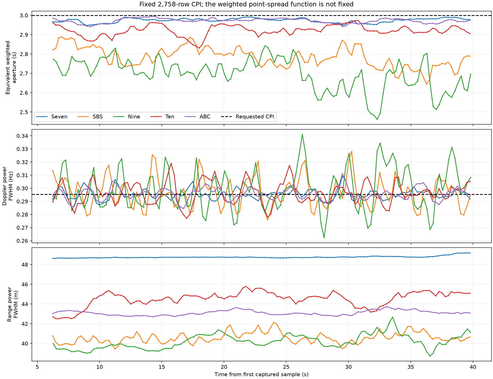

# Scientific pipeline review, 11 October 2026

This review separates mathematical identities, conditional statistical results,
and assumptions that the recording cannot establish. The earlier real-recording
“within 1 dB” certificate remains **unproven**. An attractive or uniform background
is not evidence of sensitivity or of a constant false-alarm probability.

## The appropriate objective

For a known echo template `s`, additive proper complex Gaussian noise with
covariance `R`, and receive vector `y`, the linear filter with maximum output SNR
is proportional to `R^-1 s`. Its bound is `|alpha|^2 s^H R^-1 s`.
For any implemented filter `w`, the relative efficiency is

```
eta = |w^H s|^2 / [(w^H R w)(s^H R^-1 s)] <= 1.
```

This follows directly from Cauchy–Schwarz after whitening. Rectangular temporal
weighting is optimal when the covariance is white and sample information is
constant. Hann trades sensitivity for sidelobes; it is not a universal optimum.
Inverse-variance weighting is appropriate only to the extent that the estimated
covariance describes the interference in the primary observations.

With an explicit nuisance subspace `A`, whitening and projecting it changes the
available bound to `|alpha|^2 ||P_perp R^-1/2 s||^2`. It is necessary to account for
the projected template, not claim nuisance cancellation is free sensitivity.
These are the standard matched-filter and matched-subspace results, not a proof
that our unknown real-world covariance or waveform model is correct.

Sources: [MIT matched filtering notes](https://ocw.mit.edu/courses/6-011-signals-systems-and-inference-spring-2018/resources/mit6_011s18lec24/),
[Scharf and Friedlander, Matched Subspace Detectors](https://api.mountainscholar.org/server/api/core/bitstreams/0bd25191-6792-419a-b526-2b4914839e17/content),
and [Kelly, An Adaptive Detection Algorithm](https://ece.iisc.ac.in/~cmurthy/E1_244/Slides/kelly.pdf).
Kelly's secondary observations are independent and signal-free with the same
noise covariance. Earlier time alone does **not** establish those conditions.

## Changes made after the review

| Stage | Review and resulting behavior |
| --- | --- |
| Common ADC retiming and channelizer | Keep one common time trajectory, absolute NCO coordinates and symmetric prototype. Fix the ensemble reference: changing confidence must not redefine its phase when transmitter clock rates differ. |
| Pilot tracking and initial reference origin | Sequential unwrap allowed a faded, noisy carrier to change the branch of subsequent carriers. Use a local complex-Gaussian likelihood for tracking, and a one-time Fourier likelihood search followed by local refinement for the initial origin. |
| FEC | Six TPS frames per live batch retain one frame of history and one of lookahead. This changes release latency, not the convolutional code or oracle. Offline defaults remain fifteen frames. |
| Oracle template | Remove the 9/16 pilot attenuation. Use the actual reconstructed waveform, including its boosted pilots. Pilot attenuation is a mismatched-filter/sidelobe tradeoff, not maximum-SNR matching. |
| Minimum-phase response | Retain the requested order-eight constraint. Do not allow it to fit arbitrary delays or arbitrary multipath. Its separation from physical multipath is not uniquely identifiable without calibration. |
| Carrier covariance | Remove same-batch maximum vetoes, median-relative loading, block-median switching and 0.5 exponential smoothing. Use one stationary transfer regression per carrier and one-batch-delayed residual-variance weights. Do not remove gain/timing nuisance from covariance while leaving it in the primary data. |
| Decoder erasures | Keep known sample times with zero information instead of discarding the whole CPI. A real time or segment discontinuity still resets history. No unknown oracle samples are invented. |
| Coherent focus | Keep the full fixed grid, finite previous-symbol context, within-symbol moments and physical-RF range migration. Normalize information weights only by a common factor that cancels algebraically. |
| Scientific output | Physical complex amplitudes are the default in both live capture and the detector CLI. Production no longer contains the empirical per-map normalizer or scales cells by it. Video previews likewise use physical map power. |
| Native display | Show physical map power, fixed per-channel colour limits, actual CPI and equivalent weighted aperture. Colour controls operate on the preview only. Live updates default to 0.25 seconds. |

The historical empirical map normalizer moved to
`support/validation/map_calibration.hpp`, for reproducing diagnostic exports.
It is **not** covariance whitening, a proven CFAR statistic or an SNR improvement.
The production detector no longer exposes it or accepts `--noise-standardized`.
`--physical-units` remains a harmless compatibility spelling. A positive scalar
applied to one cell scales its signal and noise equally; its physical SNR does
not improve. Empirical scaling can still mislead comparisons and thresholds.

### Pilot likelihood

Conditioned on an anchor `p_k`, the model is
`z_k = a p_k exp(i b k) + epsilon_k`, with independent equal-variance complex
Gaussian innovations. Eliminating the unknown complex gain gives

```
b_hat = argmax_b |sum_k z_k conj(p_k) exp(-i b k)|^2.
a_phase = arg(sum_k z_k conj(p_k) exp(-i b_hat k)).
```

A bounded local Newton solve with likelihood-increasing backtracking chooses
the continuous branch. This is not a global delay search. Equal-variance
innovations and a known anchor are conditional assumptions; anchor uncertainty,
colored pilot noise and changing multipath prevent an unconditional CRLB claim.
The receive timing corrections still go through the shared ADC clock.

### Carrier covariance model

The secondary batch uses source-divided observations `r_s,k = y_s,k/x_s,k`.
Known source power `p_s,k = |x_s,k|^2` supplies the statistical weight because
`Var(r_s,k) = D_k/p_s,k`. A weighted carrier mean removes its constant transfer.
This mean may contain propagation phase and stationary multipath: it is a
**noise-estimation nuisance**, never the minimum-phase hardware/echo template.

With `N_k` valid source observations, the estimate is

```
mu_k = sum_s p_s,k r_s,k / sum_s p_s,k
D_hat_k = sum_s p_s,k |r_s,k - mu_k|^2 / (N_k - 1).
```

For independent innovations with covariance `D_k/p_s,k`, this is the unbiased
weighted residual variance after fitting one complex mean. A weighted Welford
recurrence evaluates it without subtracting two large energy sums. One GPU pass
and two small variance buffers replace the prior multi-pass nuisance estimator.
Only the following batch uses the resulting variance as its prediction. A new
primary echo cannot determine its own weights; persistent echoes in earlier
training remain a limitation. Changing gain/phase/timing is retained in the
estimated residual, because it is still present in the primary observations.
Discarding such modes from covariance without a corresponding justified primary
projection would underestimate interference.

There is no block-median switch, spectral clipping, same-batch maximum veto,
median-relative loading, or exponential variance history. The `1e-30` floor is
numerical protection against zero, not a fraction of the median noise floor.
This is a **diagonal covariance approximation**, not a full-covariance optimum.

### Clock reference definition

The fitted phase offsets from independent transmitters drift apart when their
sample clocks differ. Inverse residual-variance weights previously changed the
ensemble's phase reference as pilot precision changed. This converted measurement
quality changes into a common receive time warp. The hardware telemetry showed
more than 0.998 correlation between most channels' successive timing increments,
while undoing the applied warp revealed much smoother individual clock histories.

The clock now follows the arithmetic ensemble of active anchored transmitters;
fit uncertainty remains telemetry. Differential acquisition supplies the clock
only until anchored fits become available; it has no phase epoch and cannot join
a phase servo. This defines a reference, rather than claiming identical unknown
transmitter clocks or an unconditional minimum-variance time standard. All receive
channels still use exactly the same continuous time trajectory. Different
transmitter rates remain measurable relative to it; a common ADC correction alone
cannot make unequal transmitter clocks identical. Membership changes and arbitrary
transmitter behavior require separate validation beyond the shared-rate tests.

## What is established and what remains conditional

The regression compares the old sequential tracker against an analytic signal
with deep frequency-selective fades, independent noise and phase wraps. It
produces 357 old branch slips, with 1.526-sample timing RMS. The likelihood fit
has no slips, 0.000825-sample RMS and 0.00322-sample maximum error. Traversing the
pilots in reverse leaves the fit unchanged.

Independent covariance tests cover white noise, a 20 dB spectral shape, an
80 dB narrow blocker. They use
known true covariance to evaluate `eta`, not the estimated noise to score itself.
Measured estimation losses are 0.00824–0.00863 dB, recorded in the accompanying regression log. A strong new echo
cannot change its own weights. This is a covariance-stage result, not the
all-stage real-recording sensitivity bound.

A second regression changes pilot precision while three transmitters have
fixed rate offsets of -0.04, 0 and +0.04 ppm. The old reference accumulated
21.8 ADC samples of one-second timing error. The fixed reference has 0.00784
ADC-sample RMS (2.45 degrees across the declared occupied span), with a 0.02098
sample worst excursion. This is an RMS-budget result under the injected model,
not a maximum-error or real-hardware three-degree certificate.

Finite time-domain tests now include boosted pilots; they compare both complex
correlation moments against an independent CPU sum. Weighted and erased-sample
VHF focus tests retain the expected complex phase, fixed CPI and common epoch.
Receiver tests check that short FEC batches neither lose nor duplicate symbols
and that every valid reconstructed carrier equals the transmitted one.

Remaining limitations matter:

- A diagonal covariance cannot describe general temporal or inter-carrier
  correlation. Flattening the finished power map does not close that gap.
- Earlier data can contain persistent target echoes or nonstationary clutter.
  The covariance estimator does not prove that training is signal-free.
- Minimum phase alone does not identify hardware separately from minimum-phase
  multipath. Order restriction and held-out injection tests constrain loss;
  they do not solve the general identifiability problem.
- Constant-path-rate focus does not match accelerating/rotating targets, and
  interpolation/guard exclusion still have finite model losses.
- Analytic phase tests do not prove the actual SDR meets a three-degree budget.
  Absolute anchored timing RMS includes arbitrary fixed offsets and is not a
  direct estimate of residual coherent phase loss.

The saved profile recording cannot be used to re-estimate upstream timing or
covariance: the necessary measured/reference carrier streams were not retained.
The previously exported videos therefore remain evidence of the old operator.
Fresh hardware tests and their limitations are reported below; artifacts
are under `docs/data/pipeline_review_20261011` and temporary captures under `build`.


## Hardware and display validation

The final test used the attached B200mini, serial `30AA097`, receiving at the
read-back rate **61,440,000.0479 samples/s**, centre **201,999,999.995 Hz**, gain
34 dB, internal clock and 56 MHz analog bandwidth. It exercised the actual FTXUI
controls, native ImPlot/Metal window, channel switching, archive drain and terminal
restoration. All five channels went through demodulation, FEC, reconstruction and
profile formation; only the selected channel was Doppler-focused for display.

- Received **2,452,881,408 samples**, approximately 39.923 seconds.
- **Zero** overflows, missing samples, host discards, timeouts or reacquisitions.
- **Zero** failed RS words in all five channels; each checked 907,994 words,
  including repeated decoder context.
- DSP headroom: **1.298 times realtime**, including the five-channel processing
  and selected-channel display/archive work; this is not isolated kernel timing.
- Seven: 8 maps projected and 8 displayed. SBS: 127 projected and 127 displayed.
  Every map used **2,758 sample rows / 3.000704 seconds** of timestamp support.
- SBS publication spacing: median **0.285 s**, maximum **0.357 s**. Decoder batches
  release about every 0.296 s, so a 0.25 s requested map interval includes occasional
  catch-up publications; it is not a camera-style uniform wall-clock frame cadence.
- SBS displayed weighted aperture: **2.641–2.886 s**. The preceding clock-bug run
  reached **1.143 s** on the same nominal three-second CPI. These are different live
  scenes, so the comparison is diagnostic, not a controlled SNR-gain measurement.
- Display age at publication: median **0.269 s**, maximum **0.425 s**, measured
  relative to the latest processed stream position. This excludes unmeasured
  hardware-to-host/queue latency and is not calibrated hardware-to-screen delay.

Intervening validation attempts with **8** and **161** UHD overflows were rejected
for continuity testing. The latter had no usable long CPI. Their summaries are
retained, and their cause has not been established; the passing final run does not
prove USB transport will never lose samples under another system workload.

Independent coefficient analysis of all five final streams gives:

| Channel | Weighted aperture, min / median / max (s) | Predicted range FWHM, min–max (m) |
| --- | --- | --- |
| Seven | 2.948 / 2.977 / 2.991 | 48.62–49.18 |
| SBS | 2.645 / 2.785 / 2.889 | 39.44–42.14 |
| Nine | 2.463 / 2.703 / 2.843 | 38.74–42.67 |
| Ten | 2.830 / 2.922 / 2.974 | 42.51–45.79 |
| ABC | 2.941 / 2.973 / 2.995 | 42.71–43.73 |

The table replays possible map times for every channel, including hidden ones,
whereas the display metrics above measure actual publication. There was one
initial invalid profile row per channel. The FWHM values are Fourier responses
of saved carrier weights under the mean-waveform point-target model, not measured
widths of unknown real targets. Different legitimate information weights need not
produce identical point-spread functions. Here the equivalent aperture is the
reciprocal temporal-weighting ENBW, `dt*(sum w)^2/sum(w^2)`; it describes weighting
shape and does not measure actual output SNR when observation noise varies.
Physical amplitude units retain the stated global normalization and phase;
they are not an absolute target-RCS calibration. No display blur, percentile equalization
or per-map noise flattening is applied to achieve these figures.



## Sensitivity evidence and its limits

The final C++ suite passed **34/34** tests after the last changes (13 CPU and
21 GPU tests, 38.31 seconds total). The new noisy-fade origin
regression recovered +127.3125 and -89.625 sample offsets with errors of about
0.000038 and 0.000063 samples. The detector-level erasure regression confirms that
one failed oracle row retains the same CPI and phase epoch, masks the unknown
observation and preserves the known point target's complex amplitude. It would
fail the previous whole-history-clearing implementation.

The native renderer and GPU pooling checks passed, as did profile-history replay
and **14** Python video-tool tests. The GPU preview leaves scientific amplitudes
unchanged and agrees with independently computed physical-power pooling.

An independent full-CPI observation-space calculation was rerun with actual
boosted pilots and the unattenuated template. The four retained conditional
cases gave **0.588–0.735 dB** loss relative to their known-covariance ideal,
including the assumed guard exclusion, three-degree clock allowance and stationary
projection allowance. It assumes the saved fitted response is the true channel,
uses a specified diagonal covariance as truth, and injects 10% log-variance error.
It does **not** establish that the real channel/noise obey those assumptions,
measure real sidelobe interference, bound full temporal covariance, or validate
arbitrary transmitter-clock mismatch. It is not an all-loss real-data certificate.

The direct evidence establishes that unsupported map scaling and pilot attenuation
are gone, the identified timing-reference bug is corrected, and the finite complex
operators pass independent phase/erasure tests. It does **not** establish global
optimality, CFAR, or a universal “within 1 dB” guarantee on live recordings. Remaining
per-transmitter rate differences also limit a nominal fixed waveform template; a
future source-time model must use those observations without separately retiming
the receive channels or erasing physical propagation phase.

Evidence: [hardware summary](data/pipeline_review_20261011/hardware-summary.json),
[actual display metrics](data/pipeline_review_20261011/display-metrics.json),
[all-channel coefficient analysis](data/pipeline_review_20261011/hardware-coefficient-analysis.json),
[conditional full-CPI calculation](data/pipeline_review_20261011/conditional-full-cpi-bound.json),
[phase/SNR regressions](data/pipeline_review_20261011/matched-tests.log),
[clock regression](data/pipeline_review_20261011/clock-tests.log),
and [source manifest](data/pipeline_review_20261011/source-manifest.json).

Reproduce the principal checks, with the configured MoltenVK environment:

```sh
cmake --build --preset release -j 6
ctest --preset release --output-on-failure
build/web-venv/bin/python support/live/validate_tui.py \
  --binary build/release/live_display_probe --hardware --native \
  --seconds 40 --archive profiles --output build/review-hardware-new
build/validation-venv/bin/python support/live/analyse_capture.py \
  build/review-hardware-new/capture/capture.dvblive \
  --output build/review-analysis-new --update 0.25
```

`live_display_probe` is an optional support target: build it explicitly before
running the hardware check. It observes the same capture/TUI/native path; it does
not replace DSP or generate synthetic preview images. The hardware check requires
the attached SDR to be idle and the Python validation environments described in
the capture documentation.
