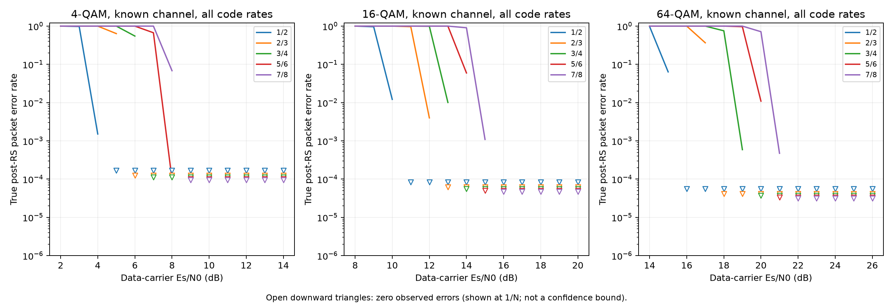
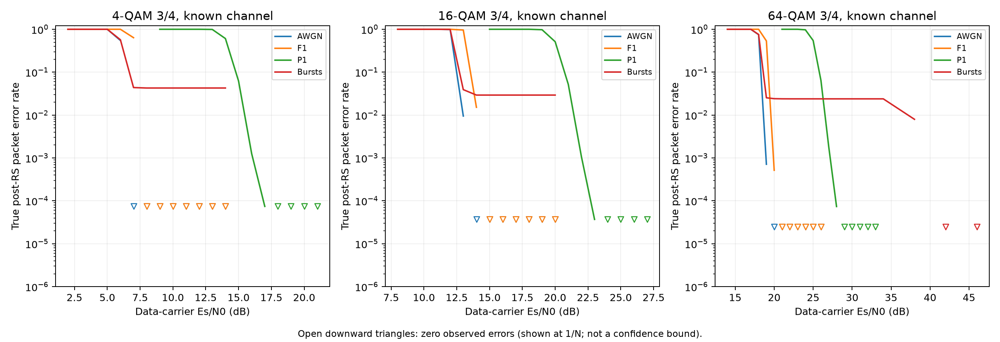
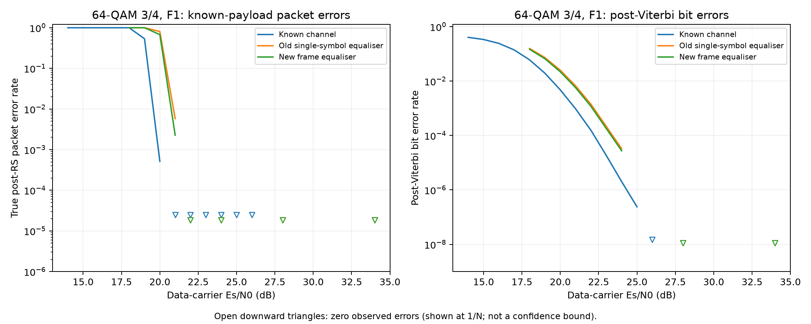
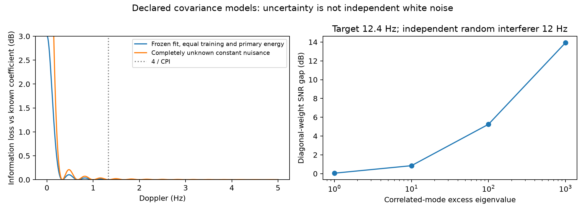

# Receiver validation and information-preservation fixes

The reported 98–99% RS acceptance is a receiver-level observation. No sample
drops were reported for those live captures. The original samples for those
captures are unavailable, so their specific failure cannot yet be reproduced.
The tests below do **not** attribute it to dropped samples or to the FEC decoder.

## FEC qualification

`support/validation/fec_waterfall.cpp` sends known random payloads through the
production DVB-T encoder, puncturing, both interleavers, constellation mapping,
hard demapping, Viterbi, outer deinterleaver and RS decoder. Reception starts
after 68 symbols of transmitted history, with unknown convolutional-code state.
Every decoded word is counted, including both ends of each batch. Accepted
words are compared with the original payload, not merely checked for a zero
syndrome. The optional diagnostic traceback measures post-Viterbi errors and
independently counts errors in each RS input word.

| Test | Observations | Result |
|---|---:|---|
| Noiseless, all 15 non-hierarchical MCS combinations | 65,442 words | No rejected or wrong accepted words |
| AWGN, all 15 MCS, 26 dB data-carrier Es/N0 | 2,094,144 words | No rejected or wrong accepted words |
| AWGN waterfall, all 15 MCS | 195 conditions; 3,402,984 word decisions | Waterfalls; no persistent high-SNR floor |
| AWGN, F1, P1 and burst noise, rate 3/4, all constellations | 39 conditions per model | Every audited word with at most eight byte errors recovered exactly |
| New equaliser, noiseless 20 µs echo, all 15 MCS | 261,768 words; 592,220,160 demapped bits | No demapped bit errors, rejected words or wrong accepted words |





F1 and P1 use the 20 path coefficients in Annex B of
[ETSI EN 300 744](https://dvb.org/wp-content/uploads/2019/12/a012_dvb-t_june_2015.pdf).
Their frequency responses are evaluated on this project's 7 MHz / 8 MS/s grid
and normalised to unit occupied-band mean power. The F1 direct component has
the specified 10 dB Rice factor. Burst noise raises noise amplitude tenfold
in one symbol per 68. The longer burst sweep recovers fully at 42–46 dB;
its roughly 2.4% packet-error plateau at lower levels is not an asymptotic
decoder floor.

The horizontal axis is **data-carrier Es/N0**, not RF C/N. The published DVB-T
reference thresholds assume an ideal receiver, while this implementation
deliberately uses hard decisions. Its 64-QAM 3/4 AWGN post-Viterbi BER crosses
2e-4 between 20 and 21 dB. Comparing that directly with the published 18.2 dB
C/N figure would mix hard-decision loss, the pilot-power convention and
implementation loss. [ETSI TR 101 290, G.12](https://www.etsi.org/deliver/etsi_TR/101200_101299/101290/01.02.01_60/tr_101290v010201p.pdf)
specifically describes its convolutional-code bound for infinite-precision
soft decisions. The independent scalar hard-metric ML comparison is the
appropriate implementation check here; it passes all puncturing patterns,
erasures, ties and tested trellis boundaries. RS parity and correction are
also checked against libfec.

Some deeply sub-waterfall conditions produce rare **wrong accepted codewords**
(for example two in the all-mode AWGN sweep). All audited occurrences had more
than eight erroneous input bytes. Bounded-distance RS decoding cannot guarantee
correctness beyond that radius; a valid syndrome is not a payload CRC. The
plots count these as packet errors. No such event occurred in the high-SNR
controls. Finite runs establish neither a zero BER for all time nor DVB QEF
performance; zero-error markers are observation resolutions, not confidence
bounds, and paired seeds across SNR points are not independent extra trials.

## Equalisation defect and fix

The original decoder used a straight complex line between scattered pilots
12 carriers apart in each individual symbol. On a noiseless channel

`H(f) = 1 + 0.8 exp(j 0.7 - j 2 pi f 20 microseconds)`,

the 64-QAM 3/4 test rejected **6,782/6,782 words**. Supplying the exact channel
to the same FEC decoder removed the failures. This is a demonstrated receiver
equalisation floor, although it does not establish the cause of the earlier
live observation.

The production frame snapshot now uses the four staggered pilot phases already
available in its buffered symbols. A pilot is interpolated between bracketing
times, giving channel observations every three carriers. Continual pilots use
their current observation. Frequency interpolation uses eight neighbouring
observations, with the known guard support centred before interpolation. The
operation uses one dense-pilot dispatch followed by the existing frame gather,
in one submission: no extra FFT or receiver buffering is introduced. Per-source
timing is removed before temporal interpolation and restored afterwards.
Single-symbol equalisation remains useful
for acquisition/TPS before a frame is available.

This is a deterministic interpolator, not an asserted LMMSE estimator for every
delay/Doppler channel. It assumes the decoder channel changes slowly over four
symbols. That assumption is tested on stationary F1/P1 and strong in-guard
multipath; very rapid channel variation and long-delay 1/4-GI SFNs are not
certified by these tests. The radar measurement is copied **bit for bit**;
decoder channel interpolation does not equalise, flatten or cancel the
scientific measurement.



The noisy F1 test shows a small improvement, rather than an inflated claim of
several dB. The major improvement is removal of the demonstrated deterministic
multipath failure. The analytic interpolation test has maximum constellation
error 6.96e-7; the physical 20 µs echo test has maximum error 7.38e-4. Full
streaming acquisition, TPS, two independent CFOs, ring wrapping, discontinuity
handling and known reconstructed carriers also pass with that echo.

## Recorded-data control

The first 20 seconds of `baseband_202000000Hz_20-55-20_10-10-2026.wav` were
replayed before the equaliser change. This interval precedes its known first
sample discontinuity. All five channels had zero rejected RS words:

| Decoder batch | Words examined per channel | Rejected, each of five channels |
|---|---:|---:|
| 15 TPS frames | 347,907 | 0 |
| 6 TPS frames, matching live capture | 451,729 | 0 |

These counts include overlapping decoder context, just as the current TUI
counter does. They are not unique transport-packet counts. Failure positions
and first/last-16-word counts are retained by `recording_probe`. The probe does
not discard boundary failures or alter the displayed acceptance denominator.

With the final receiver and frozen stationary prediction, the later, held-out
part of that 20-second replay gives the following **received-power / residual-power
reductions**, measured on valid occupied carriers:

| Channel | Reduction after frozen prediction | Rejected RS words, full 20 s |
|---|---:|---:|
| Seven | 30.00 dB | 0 |
| SBS | 34.29 dB | 0 |
| Nine | 33.82 dB | 0 |
| Ten | 27.97 dB | 0 |
| ABC | 27.91 dB | 0 |

The ratios include residual noise, moving returns and model mismatch. They are
not isolated direct-path suppression measurements or target-SNR gains. The
minimum-phase fit alone reduces total occupied-carrier power by 12.0–16.4 dB
over the full interval; it deliberately does not model the complete stationary
multipath transfer. The frozen optional stationary branch removes substantially
more of that transfer. No empirical cell or Doppler-band normalisation is used.

## Minimum-phase solver

The partial occupied Fourier band makes the original real cepstral coordinates
poorly conditioned. Increasing coordinate-descent iterations barely helped.
The new solver orthogonalises those coordinates once, carrying their imaginary
companions through the identical transformations. It represents the same
causal minimum-phase model and keeps the same iteration count. Magnitude is
recomputed from the fitted coefficients after each sweep, preventing float
amplitude products from stalling while the phase coefficients continue to drift.

For the original exactly representable, noiseless test with 408 rows and order
eight, relative complex response-error power is now **1.25e-14 (−139.0 dB)**,
versus **−38.4 dB** previously. Phase RMS is **4.54e-6 degrees**. These are
synthetic numerical errors, not a claim of 139 dB cancellation on recorded RF.
Analytic truth, masks, explicit delay origin, pure all-pass rejection and moving
echo phase are covered by regression tests. Models whose partial-band phase
continuation loses half the float significand are now rejected explicitly;
the previous order-32 setting is numerically unidentifiable on this band.

Convergence does not establish statistical optimality. In particular, the
magnitude-based fit is not the joint complex likelihood of hardware, scene and
noise. A finite minimum-phase model cannot uniquely distinguish hardware from
all short-delay echoes. Increasing its degrees of freedom to reduce total
residual power would not be a justified way to improve target sensitivity.

## Independent transmitter timing and coloured pilot noise

Every receive channel still uses the **same ADC time map**. Each source now
exports its timing offset and rate relative to that grid. The receiver steers
its integer FFT read window to stay inside the prefix, subtracts that known
motion from clock observations, and retains absolute window coordinates. The
source offset drives reference phase in response fitting, subtraction,
equalisation and finite-waveform range compression. It does not warp a receive
channel independently or become an all-pass response coefficient.

The full streaming test injects two clocks at +0.25 and −0.19 ppm, separate
CFOs, strong 20 µs multipath, arbitrary input blocks and a large sample epoch.
Known reconstructed carriers and all FEC words pass. The final rate estimates
are +0.2576 and −0.1958 ppm; FFT/phase metadata agrees with a CPU waveform oracle
to 2.01e-7 relative RMS. A separate finite-waveform test crosses both fractional
phase wraps and the guard boundary. Its maximum echo phase error is **0.0030°**.

This is a constant source-phase model within each OFDM symbol. It does not
claim to remove all intra-symbol dilation/ICI. At residual rate 0.25 ppm, the
worst occupied-edge phase excursion from the symbol centre is **0.1534°**;
at 40 ppb it is **0.02454°**. These are analytic bounds on that omitted component,
not measured total receiver phase errors. The 0.25 ppm worst-case waveform-error
power bound is −51.45 dB; the corresponding 40 ppb bound is −67.37 dB. Consequently
the −139 dB solver result must never be advertised as an RF cancellation depth.

Pilot phase/timing likelihoods now accept inverse additive-noise variances.
Stable source-conditioned residual scatter is calculated in the existing GPU
response reduction. An earlier decoded frame supplies weights for later pilot
observations; acquisition starts with equal weights, and reacquisition clears
them. There is no map-derived weighting or new waveform FFT.

The independent 6,000-trial test puts 20 dB more additive noise on one fifth of
the continual pilots. With 408 independent secondary observations for each
variance, timing MSE/CRLB falls from **17.36 to 1.027**. Including a noisy
32-symbol anchor gives **1.003** against the corresponding nuisance-aware bound.
White-noise cases are 1.019–1.020. The approximate 95% relative sampling variation
of these variance ratios is ±3.6%. Explicit prewhitening gives the same solution.
These are declared Gaussian, diagonal-covariance tests; unknown temporal or
cross-carrier correlations and model mismatch are not thereby certified.

## Cancellation uncertainty and correlated interference

The frozen stationary predictor previously averaged statistics containing
overlapping decoder context and then scaled them by the new-row fraction. That
does not make the observations independent. Training now uses the existing
noise reduction's **unique new rows**, and combines per-batch complex transfer
estimates by their conditional precision. The first published aperture still
excludes the full training fit's decoder context, because `H` used it:

```text
Ghat = sum(Y conj(X)) / E,       E = sum(|X|²)
beta = Ghat/H - 1,              precision(beta) = E |H|² / D
Vbeta = 1 / sum(precision(beta))
```

`D` is source-conditioned residual variance with one complex fitted-mean degree
of freedom removed. Noise/receiver gain changes therefore have their stated
statistical effect on training weights. A test deliberately corrupts all
overlapping context, steps innovation power by 20 dB, and uses 6,817 independent
carrier trials to check the predicted coefficient-error variance: measured
error power / predicted variance is **0.9960**. Training still
freezes before the published aperture; future echoes cannot update it.

The complex profiles retain the frozen coefficient variances. For independent
training error, the subsequent observation covariance is

```text
R_eff = R + A Vbeta A^H,         A[row,k] = H[k] X[row,k].
```

That term is correlated across rows. Adding its diagonal to a white-noise
estimate would give the wrong integration behaviour. The saved variance is
conditional on `H`, the source and independent training innovations; it does
**not** account for response-model bias, uncertainty of the fitted `H`, or an
unknown interference covariance. These distinctions are carried in metadata.

For a specified covariance, the correct matched score and information are
`s^H R_eff^-1 y` and `s^H R_eff^-1 s`. With a deterministic unknown nuisance `B`,
use its whitened orthogonal projection on **both** observations and templates;
the Fisher bound is the nuisance Schur complement. The Woodbury calculation
and 16,000-trial score-variance checks in `cancellation_likelihood.py` agree with
independent dense solves. For the simple constant-nuisance, equal-training-energy
model, information loss outside `4/CPI` is at most 0.011 dB relative to a known
coefficient (0.022 dB when it is completely unknown). Those numbers are specific
to that model, not a whole-pipeline loss budget.



**A universal within-1-dB or CRLB-tight claim is still not justified.** The
declared correlated-interferer counterexample retains a 5.25 dB gap with diagonal
whitening. No blind temporal whitening was added: the target reflections and
interference are both present in residual data, and their separation is not
identifiable without a nuisance/covariance model or independent evidence. The
compact profiles support the specified finite-waveform, small-Doppler focusing
operator; coefficient variances alone are not the complete template Gram matrix
for arbitrary future SAR trajectories. This is an explicit remaining limit,
not a newly claimed sensitivity gain or a reason to flatten scientific maps.

## Runtime and final validation

The available VHF capture was replayed for 20 seconds, before its known first
discontinuity. The final live-size six-frame run examines 451,729 words per
channel, including decoder context. All five channels have zero rejected words.
This does not identify the cause of the unavailable live captures' 98–99% result.

The numerical pipeline benchmark preloads input before measurement, warms up for
10 seconds, and excludes file reads, packet checksumming and video encoding.
It uses five actual VHF channels, five FEC workers, 3-second maps at ±100 Hz and
one map per channel per second. FEC timings are **elapsed durations summed across
workers**, not thread CPU counters. Aggregate active CPU time is measured
separately with the process CPU clock. GPU values are device timestamps. These
quantities overlap and must not be added as wall time.
The 15-frame configuration measures 622.9 ms wall time per input second (**1.61×
real time**) and 1,027.2 ms aggregate process CPU time per second. This is a
current workload measurement, not a before/after speedup: the earlier UHF file
is no longer available and had a different MCS.

The six-frame live configuration measures **868.0 ms/input-second (1.15× real
time)** with 1,256.0 ms aggregate process CPU time/input-second. Its extra context
and more frequent fixed-size response solves cost more than the 15-frame mode.
This leaves about 13% wall-time headroom in this run, not a guarantee of zero
hardware drops under every display/writer load. No new live UHD capture was made.

| Stage | Owner | 15 frames, ms/s | Live 6 frames, ms/s |
|---|---|---:|---:|
| Channelisation/shared retiming | GPU | 39.79 | 51.52 |
| Receiver FFT/sync | GPU | 45.98 | 58.96 |
| Frame gathering/equalisation | GPU | 22.91 | 32.36 |
| Oracle reconstruction | GPU | 28.37 | 54.88 |
| Response fit/subtraction | GPU | 29.02 | 83.28 |
| Carrier noise estimate | GPU | 7.86 | 12.60 |
| Finite range compression | GPU | 95.36 | 137.48 |
| Range–Doppler focus | GPU | 49.10 | 54.25 |
| Hard demapping | CPU workers, elapsed | 128.44 | 176.19 |
| Viterbi | CPU workers, elapsed | 557.25 | 700.97 |
| RS | CPU workers, elapsed | 22.21 | 28.07 |

The final regression run passes **37/37 C++ tests** and **25 Python support
tests**. This includes analytic response truth, finite beyond-guard correlation,
independent clock drift, complex phase, coloured-noise timing, cancellation
uncertainty, complete receiver/FEC/reconstruction and archive compatibility.

## Reproduce

Build `fec_waterfall`, `recording_probe`, `sensitivity_response` and the tests
using the release preset. Vulkan runs on this Mac require the bundled MoltenVK
ICD. Example qualification commands:

```sh
build/release/support/validation/fec_waterfall --model awgn --blocks 8
build/release/support/validation/fec_waterfall --inspect --rate 2 --model p1 --blocks 12
build/release/support/validation/fec_waterfall --frame-pilots --clean --inspect --model echo --blocks 8
build/release/receiver_tests --multipath
build/release/support/validation/sensitivity_response --rows 408
```

Raw results and regression logs are in
[`docs/data/fec_validation_20261011`](data/fec_validation_20261011).
Plots are reproducible with `support/validation/plot_fec_validation.py` using
the existing validation venv; no production plotting dependency was added.

Additional commands (explicitly rebuild optional tools after library changes):

```sh
cmake --build --preset release --target recording_probe fec_waterfall information_probe detection_pipeline_benchmark
build/release/receiver_tests --independent-clocks
build/release/support/validation/information_probe
MPLCONFIGDIR="$PWD/build/cache/matplotlib" build/validation-venv/bin/python \
  support/validation/cancellation_likelihood.py \
  docs/data/fec_validation_20261011/cancellation-likelihood.json \
  docs/figures/fec_validation_20261011/cancellation_likelihood.png
```

The full five-channel benchmark command is recorded in the validation manifest;
its last argument selects 15-frame or live six-frame batches.
