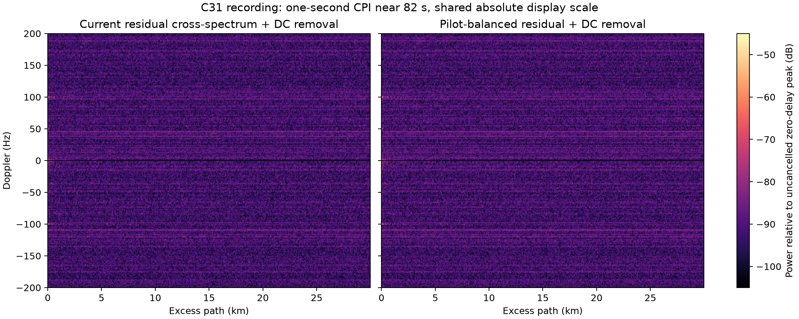
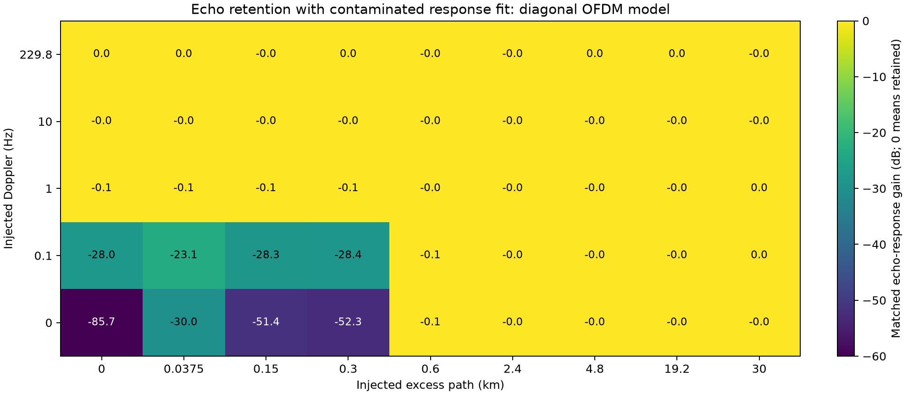
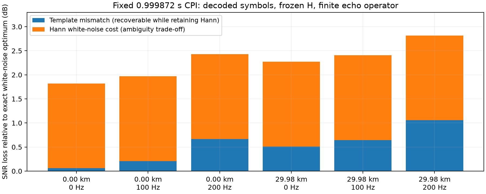
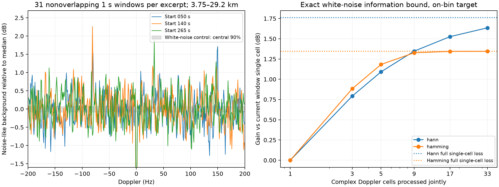
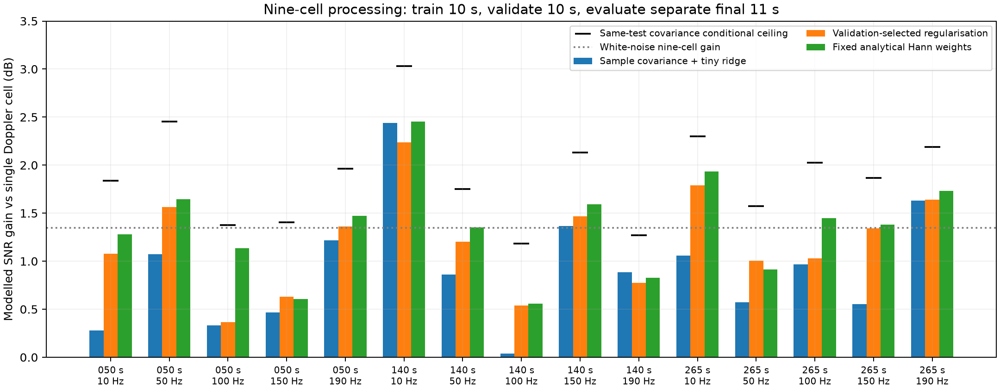
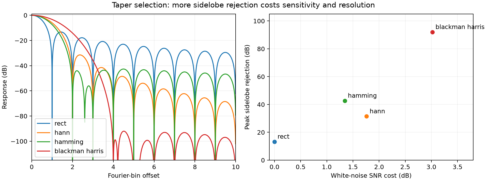
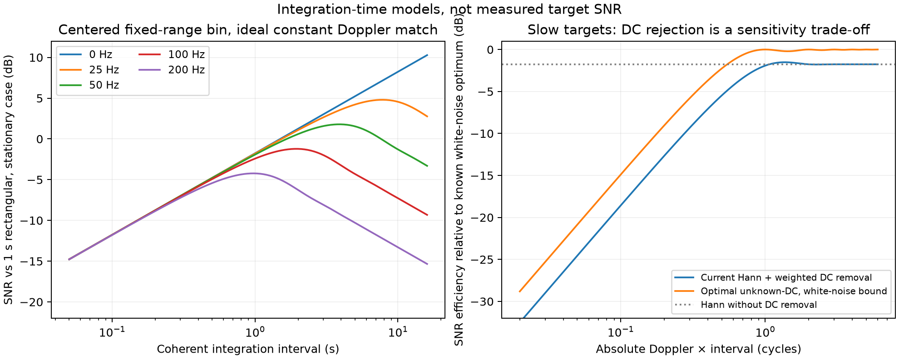

# Sensitivity audit: reconstructed DVB-T reference and integration time

**6 October 2026. Display region: 0–30 km excess path, ±200 Hz Doppler.**

**Follow-up:** [the production improvements and corrected analysis](sensitivity_improvements_20261007.md)
supersede this report's averaged band statistic and its carrier-noise proxy.
Individual maps have much stronger banding, and source-divided differences
retain a coherent narrowband interferer missed by the earlier estimate.
The follow-up separates conditional model efficiency from a real-data optimum
certificate and includes production code, runtime measurements and validation.

There is room for improvement. The reconstructed reference removes reference
receiver noise and exposes the exact transmitted symbols, but a plain residual
cross-spectrum is optimal only for a matching waveform in white noise, with the
appropriate motion and nuisance assumptions. The biggest demonstrated artefact
improvement is pilot-power balancing. Within the requested ±200 Hz region,
window selection, residual-noise weighting and integration-time selection are
more relevant; the strong pilot ghost lies outside this view.

The central result for a **fixed coherence interval** is that the current
map is not information-optimal. A controlled one-second test with reconstructed
recording symbols measures **1.82–2.82 dB** loss against the exact white-noise
matched-filter bound over the tested 0–30 km / 0–200 Hz cases. Of that, about
1.76 dB is the deliberate Hann trade-off; approximately 0.06–1.06 dB comes
from waveform weighting and the diagonal echo approximation. With the measured,
held-out diagonal carrier-noise model, the conditional gap becomes **2.33–3.32 dB**.
Neither is a ceiling for arbitrary real residual covariance. The bound and its
assumptions are proved below; a production implementation plan is deferred.

**Doppler processing also matters.** Hann correlates neighbouring complex cells.
Nine-cell joint matched processing recovers **1.347 dB** in the white-noise model,
within the existing 1.76 dB window budget. Across disjoint recording intervals,
fixed analytical weights give a median **1.38 dB modelled gain** in the retained
map. Row noise normalization alone improves threshold consistency but does not
increase SNR. The recording's Doppler-dependent background also varies more than
the white-noise control, so its bands are not explained by Hann alone.

This audit adds opt-in analysis tools, not a change to production DSP. It
separates measurements from model predictions and from candidate improvements.
[Reproduction instructions](../support/validation/README.md),
[saved numerical results](data/sensitivity_20261006/README.md) and standalone
PDF figures accompany the report. Large spectral archives remain in
`build/sensitivity-20261006/`.

## Recording and measurement procedure

The C31 recording is
`/Users/danielrd/data/dvbt_passive_radar/baseband_553000000Hz_12-51-54_26-09-2026.wav`.
Three independent 32-second excerpts start at 50, 140 and 265 seconds. Each
passes through the current production frontend, demodulation, hard FEC,
reconstruction and order-8 minimum-phase response fit. Analysis uses the
scientific `DVBTSAR1` spectral handoff, rather than video pixels.

The decoded channel is 8K/QPSK, rate 3/4, guard 1/16, at 8 MS/s. The physical
RF is 557.625 MHz; the recording centre and channel NCO are 553 MHz and
+4.625 MHz. The useful symbol is 1.024 ms, the complete symbol is 1.088 ms,
and 6,817 occupied carriers span approximately 6.657 MHz. Excess-path resolution
is approximately 45 m; the plotted sample grid is 37.474 m. These are bistatic
**excess-path** distances: no monostatic factor of two is applied.

Each excerpt supplies 29,168 contiguous, completely reconstructed rows after
excluding four partial endpoint rows. The corrected time grids remain continuous
across batch boundaries. An independent double-precision replay of
`E = Y − H X`, including the exported fractional reference origin, agrees with
the GPU residual-energy fraction within **1.20×10⁻⁸** over all three excerpts.
The audit retains every 1.088 ms range profile, as did the previous ±300 Hz
videos. Here ±200 Hz is the displayed region. Production's optional slow-time
decimation filter and padded FFT would need their own exact covariance if used;
the video exporter normally selects decimation two for a new ±200 Hz export.

## How much direct-path suppression is achieved?

There are several different quantities; total residual energy alone does not
answer this question. In particular, wanted stationary and moving reflections
also contribute to residual energy.

| Excerpt | Median total-power reduction | Median coherent zero-delay reduction per batch | Median reduction projected onto fitted direct template |
|---|---:|---:|---:|
| 50–82 s | 12.57 dB | 36.13 dB | 35.46 dB |
| 140–172 s | 12.54 dB | 36.10 dB | 35.37 dB |
| 265–297 s | 12.52 dB | 36.07 dB | 35.25 dB |

The first column is `10 log10(Σ|Y|² / Σ|E|²)`. The second compares
`|Σ Y X*|²` with `|Σ E X*|²` at zero excess delay and zero Doppler.
The third projects before and after subtraction onto `H X`; it measures a
different, shaped direct-path coordinate. The approximately **35–36 dB** values
are useful operational suppression measurements, but do not isolate a pure
physical direct ray from unresolved nearby stationary reflections.

The final one-second Hann maps give zero-delay reductions of 36.22, 35.88 and
36.03 dB; ten-second maps give 36.10, 36.06 and 36.05 dB. The far-range,
nonzero-Doppler background median corresponds to about −89.8 dB relative to
the uncancelled direct peak at one second and −99.6 dB at ten seconds.
That background statistic includes interference and targets; it is not a
calibrated thermal-noise measurement. Its approximately 10 dB decrease is
consistent with ten times longer integration of a noise-like component.

To keep direct-path leakage below that background, a 36 dB cancellation depth
still needs roughly **54 dB additional ambiguity rejection at one second**, or
64 dB at ten seconds, at the cell being tested. A single peak sidelobe number
does not establish this over the whole map: the two-dimensional ambiguity
function and local residual direct response determine the leakage.

## Pilot ghost and mismatch-filter trade-off

The known scattered-pilot structure produces an ambiguity feature at
`8192/12` samples, or **25.581 km**, and `1/(4×1.088 ms)`, or **229.779 Hz**.
This is outside the newly requested ±200 Hz view.

| CPI | Ghost relative to original direct peak | Reduction from pilot balancing, three excerpts |
|---|---:|---:|
| 1 s | −47.0 to −46.9 dB | 37.4–39.9 dB |
| 10 s | −47.0 to −46.9 dB | 49.9–51.2 dB |

The ordinary `E X*` cross-spectrum retains the periodically boosted pilot
power. For this QPSK signal, a comparison using `E/X`, with a constant gain
calibration and the same weighted DC removal, removes that power modulation.
A decomposition using each batch's coherent stationary transfer reproduces
98.5–101.7% of the ghost peak power: evidence that the stationary residual,
through the pilot pattern, explains the feature. This same-data decomposition
is a diagnostic, not an independent prediction or an additive power partition.

The ideal white-noise sensitivity cost of this balancing is **0.134 dB** for
the reconstructed QPSK symbols. It is a deliberately mismatched filter: we
trade a small amount of white-noise gain for much lower ambiguity. This is
consistent with published DVB-T passive-radar work using pilot equalisation
to suppress ambiguity sidelobes. [Experimental DVB-T study](https://pmc.ncbi.nlm.nih.gov/articles/PMC5087383/).

This result should not be extrapolated to dividing by every 64-QAM symbol:
small-amplitude payload symbols can amplify noise substantially. Balancing
the known pilots separately is a cleaner generalisation. No such filter has
been enabled in production by this audit.



Both maps use a one-second window ending near 82 s, the same physical gain
calibration and the same −105 to −45 dB display scale. Within ±200 Hz the
images are similar, as expected when the principal removed ghost is outside
the view. [Standalone PDF](figures/sensitivity_20261006/pilot_balanced_map.pdf).

## Stronger cancellation can also remove wanted echoes

Minimum phase excludes an isolated all-pass delay, but **does not exclude weak
multipath added to a stronger direct path**. The transfer `1 + a z⁻ᵈ` is itself
minimum phase for `|a| < 1`. Its delayed component can therefore enter a
minimum-phase hardware-response estimate.

The new Vulkan probe injects a −40 dB echo into the measured signal **before
refitting** with the production order-8, 16-iteration estimator. Paired
baseline subtraction isolates the recovered echo from baseline fit error.
The known baseline response has 1.20% relative complex RMS error at the
production iteration limit; the paired definition removes this baseline
error from the echo-retention metric. This also shows that the constrained
numerical fit is not an exact solution even for this known synthetic response.

| Echo excess path | Doppler | Matched echo-response change after refitting |
|---|---:|---:|
| 37.5 m | 0 Hz | −30.0 dB |
| 149.9 m | 0 Hz | −51.4 dB |
| 299.8 m | 0 Hz | −52.3 dB |
| 149.9 m | 0.1 Hz | −28.3 dB |
| 149.9 m | 1 Hz | −0.082 dB |
| 599.6 m | 0 Hz | −0.128 dB |
| 2.398 km | 0 Hz | −0.0052 dB |

These numbers are complex matched-projection gains, expressed as
`20 log10(|gain|)`, not changes in total residual power. The frozen-response
paired control is unity analytically. Long-delay rows in the probe use the
diagonal OFDM model; they do not qualify physical beyond-guard echoes.



The existing apply-only response test remains valid, but injecting an echo
after fitting cannot detect this self-subtraction. Increasing response order
or freeing its complex phase could deepen cancellation while reducing useful
sensitivity. Without calibration or a stronger hardware/scene prior, the two
components cannot be uniquely separated. Slower updates, regularisation and
held-out validation can reduce statistical overfit; held-out samples cannot
resolve a consistent physical hardware-versus-static-scene ambiguity.

## Conditional optimum for a fixed interval

Let `r` be the retained complex receive data after the specified nuisance
handling, `q(τ,f)` the exact received echo template, and `C` its noise covariance.
For an unknown complex echo amplitude in proper complex Gaussian noise,

```text
z = qᴴ C⁻¹ r / sqrt(qᴴ C⁻¹ q)
ρoptimal = |a|² qᴴ C⁻¹ q
η(w) = |wᴴ q|² / [(wᴴ C w)(qᴴ C⁻¹ q)] ≤ 1.
```

**Proof:** set `u = C^(1/2) w` and `v = C^(−1/2) q`. Cauchy–Schwarz gives
`|uᴴv|² ≤ (uᴴu)(vᴴv)`, which is exactly the efficiency inequality. Equality
holds if and only if `w` is proportional to `C⁻¹q`. This proves maximum SNR
for every linear detector with this template and positive-definite covariance.
Under the stated Gaussian model, maximising the likelihood over the unknown
complex amplitude gives the same `|z|²` statistic. It is a conditional
likelihood result, not a uniformly optimal detector for every unknown scene.

For a complex amplitude estimate, use `â = qᴴC⁻¹r/(qᴴC⁻¹q)` instead.
This has unit complex response to the specified template and keeps its phase
reference. All diagnostic operations here retain the shared sample timestamps;
no channel is independently retimed. A covariance transform must keep its
template and amplitude normalization explicit to preserve coherent phase.

Consequently a rigorous fixed-CPI certificate must specify the observation
operator, echo family, covariance and nuisance treatment, then show that its
actual weights attain this equality. FEC-valid oracle symbols alone do not
establish any of these other conditions. There is no defensible proof that
the current recorded-data detector leaves nothing on the table.

The detector uses `|z|²`; this is the matched-filter/GLRT benchmark conditional
on a template and covariance. In white noise it reduces to correlation with
the actual received waveform. A spectral division that sharpens the peak is
not automatically an SNR improvement: it also changes noise covariance.
For nuisance columns `A`, whiten both `A` and `q` and project out the specified
nuisance subspace before evaluating the statistic. Every such projection can
also remove target information where the target resembles the nuisance.
Methods for known-signal detection with unknown coloured noise are well
established. [Kay's primary paper](https://digitalcommons.uri.edu/ele_facpubs/1403/).

The oracle is valuable because it supplies known source symbols without noisy
reference-channel samples. It does not make the propagation response, transmitter
phase noise, PA distortion or residual covariance perfectly known. A linear
frequency response also cannot represent arbitrary nonlinear PA distortion.
If response parameters are learned from the tested data, the benchmark must
include the estimator's effect on both signal and noise; the echo-retention
probe measures one part of this effect.

On these excerpts, using the fitted `H X` instead of `X` as the white-noise
echo template would recover only **0.054–0.062 dB** of frequency-weighting loss.
The fitted response is sufficiently flat that this alone is a minor change.
The earlier 1.88–4.69 dB opportunity from a source-divided first-difference
proxy is **not retained as a sensitivity claim**. That proxy mixes common
gain/phase/timing changes with independent carrier noise. Removing two diagnostic
common modes before estimating physical carrier variance gives a much smaller
conditional result: **0.56–0.62 dB**, including shaped-template weighting.
The mode separation is used only in support analysis; it does not cancel
additional reflections in production.

### A strict upper bound when an independent noise floor is known

Suppose `C = D + K`, where `D` is a known, positive-definite independent
receiver-noise covariance and `K` is positive semidefinite. Whitening by `D`
gives `C = D¹ᐟ² (I + D⁻¹ᐟ² K D⁻¹ᐟ²) D¹ᐟ²`. The middle inverse has
eigenvalues at most one, hence `C⁻¹ ⪯ D⁻¹` and

```text
SNRopt ≤ |a|² qᴴ D⁻¹ q.
```

This is a rigorous ceiling even when the additional interference covariance is
unknown. It is conditional on a genuine independent floor: a variance estimate
from the received scene is not sufficient to establish `C ⪰ D`.

Without that calibration or a statistical scene/noise assumption, the recording
does not uniquely identify a noise covariance. The same random-looking energy
can be modelled as unresolved returns, interference or receiver noise. Therefore
there is **no defensible unconditional numerical gain ceiling** from these data
alone. The exact `qᴴ C⁻¹ q` bound remains available for each stated model; a
blanket assertion that only two dB is possible does not follow.

For improper complex noise, covariance `C` alone is insufficient. Stack real and
imaginary observations and use their full real covariance `R`. For unknown
complex amplitude the two real template columns are
`Q = [[Re q, −Im q], [Im q, Re q]]`, and their information matrix is
`J = Qᵀ R⁻¹ Q`. The likelihood detector uses the resulting two-dimensional
subspace. The separated carrier innovations are close to proper noise here,
but the common modes have pseudocovariance/covariance norm ratios around
0.58–0.61; treating those modes as circular white noise would miss structure.

### How much of the actual noise model is validated?

`covariance_bound.py` separates fitted-response and timing-slope modes in
source-divided coordinates, then estimates physical carrier variance from
first differences of the remaining innovations. Typical normalized power
medians are 0.99–1.00 times the proper-Gaussian prediction, normalized fourth
moments about 1.03–1.04, and measured temporal lag correlations around 0.007–0.008.
These are consistency checks, not proof of independence; the initial batch is
less Gaussian. A low-rank Woodbury calculation and an augmented-real calculation
also quantify common-mode effects under an explicitly white slow-time model.
That model does not establish their true Doppler spectrum.

| Excerpt | Carrier weights learned in first half, evaluated in second half | Exact diagonal bound using second-half variance |
|---|---:|---:|
| 50–82 s | 0.557 dB | 0.563 dB |
| 140–172 s | 0.576 dB | 0.590 dB |
| 265–297 s | 0.615 dB | 0.617 dB |

The weights nearly attain the conditional diagonal bound on held-out data.
However, the measured far-range, nonzero-Doppler map background is **1.57–1.66
times**, or **1.96–2.19 dB**, above this model's predicted Hann variance.
Consequently this is **not a complete covariance certificate for the recording**.
The excess could contain coloured or signal-dependent residuals and wanted
returns. It must not be added as an automatically recoverable gain, nor can it
be assumed independent across range and Doppler.

### Controlled fixed-CPI comparison using the actual decoded symbols

`support/validation/matched_filter_probe.py` uses 919 decoded symbols from the
first excerpt, a **0.999872-second interval**, and its frozen fitted response.
It reconstructs the continuous OFDM waveform with CP and adjacent symbols,
applies an integer baseband delay and within-window Doppler modulation, then
applies the exact receive FFT and active-carrier measurement operator. The
comparison uses independent, equal-variance white carrier noise.
DC removal is disabled here to isolate template and taper losses; its
target-information loss is analysed separately below. The response is frozen,
so these bounds do not account for adaptive self-subtraction.

This deliberately fixes the baseband delay while frequency-shifting the echo:
it isolates waveform-model loss, rather than including target range migration
or acceleration. It is the usual narrowband CAF echo model, not a full physical
constant-velocity trajectory. The fitted hardware response is assumed true
in this controlled comparison; it is not independently calibrated.

| Excess-path delay | Doppler | Current X-template + Hann loss | Current X-template, rectangular loss | Exact shaped template, rectangular loss |
|---|---:|---:|---:|---:|
| 0 | 0 Hz | 1.820 dB | 0.059 dB | 0 dB |
| 0 | 100 Hz | 1.970 dB | 0.209 dB | 0 dB |
| 0 | 200 Hz | 2.427 dB | 0.666 dB | 0 dB |
| 29.98 km | 0 Hz | 2.271 dB | 0.510 dB | 0 dB |
| 29.98 km | 100 Hz | 2.406 dB | 0.645 dB | 0 dB |
| 29.98 km | 200 Hz | 2.817 dB | 1.056 dB | 0 dB |

These are calculated SNR efficiencies using the full complex finite template
and the covariance bound above, not differences in displayed peak amplitude.
The exact template attains `η = 1` to numerical precision for all 20 cases.
The table supplies a theoretical bound and a reproducible controlled measurement
of the gap for the defined data and echo operator. It does not certify the
unknown real noise covariance or adaptive-response behaviour.



[Standalone PDF](figures/sensitivity_20261006/fixed_cpi_loss.pdf).

Retaining Hann but correcting the echo template can recover roughly **0.06–1.06
dB** in these cases; removing Hann's 1.76 dB penalty is a separate clutter and
ambiguity trade-off. ICI and beyond-guard losses interact, so their scalar
approximations should not simply be added. Covariance gains should also be
evaluated jointly with the corrected template.

Repeating the same finite-waveform calculation with the first excerpt's
second-half carrier variance gives:

| Delay / Doppler | White-noise gap | Held-out diagonal-noise gap |
|---|---:|---:|
| 0 / 0 Hz | 1.820 dB | 2.327 dB |
| 0 / 100 Hz | 1.970 dB | 2.477 dB |
| 0 / 200 Hz | 2.427 dB | 2.934 dB |
| 29.98 km / 0 Hz | 2.271 dB | 2.778 dB |
| 29.98 km / 100 Hz | 2.406 dB | 2.913 dB |
| 29.98 km / 200 Hz | 2.817 dB | 3.324 dB |

These columns are alternative covariance assumptions for the same observations,
not independent gains to sum. Correcting waveform and diagonal noise weights
while retaining Hann gives **0.57–1.56 dB** in this model; the remaining
approximately 1.76 dB is the taper trade-off. The full real covariance can
change this ceiling in either direction relative to this diagonal assumption.

For diagonal stationary noise covariance, the corrected spectral correlation
is `E × conj(H X) / σ²(k)`. These extra scalar weights are inexpensive and
preserve phase when their complex reference and normalization are explicit.
Handling ICI and adjacent-symbol coupling requires the correct finite operator;
it cannot be repaired by a different scalar weight alone. This comparison
does not require a track, acceleration search, autofocus or ISAR processing.

Delay/Doppler Cramér–Rao bounds provide a complementary localisation benchmark.
In the simple white-noise, known-waveform case with unknown complex amplitude,
the uncoupled bounds are `var(τ) ≥ 1/(8π²ρ βrms²)` and
`var(f) ≥ 1/(8π²ρ trms²)`. Coupling and nuisance parameters require the full
information matrix. CRBs do not certify low-SNR detection performance, and
unknown-signal passive radar has additional information loss.
[Chen and Blum's passive-radar bounds](https://arxiv.org/abs/1805.01533).

## Doppler banding, whitening and covariance regularisation

Three 32-second excerpts each provide 31 nonoverlapping 0.999872-second windows.
For each Doppler row, a background proxy is the range median of power divided
by `ln 2`, using 3.75–29.2 km. Averaging these proxies over time gives the
following profile; Dopplers within 5 Hz of DC are excluded from the quantiles.

| Data | 5th percentile relative to median | 95th percentile |
|---|---:|---:|
| 50–82 s | −0.738 dB | +0.726 dB |
| 140–172 s | −0.646 dB | +0.760 dB |
| 265–297 s | −0.663 dB | +0.801 dB |
| White occupied-band noise, same FFT/window/estimator | −0.080 dB | +0.070 dB |

The control uses 31 independently generated windows with the actual occupied
carrier band and the same range restriction, so it includes range correlation,
Hann and DC removal. The recording therefore has appreciable Doppler-dependent
background beyond sampling fluctuations. The range median includes unresolved
returns; this evidence does **not** assign the bands uniquely to DVB-T structure.
The profile is also not perfectly stable: second-half/first-half row-power
ratios have 5th–95th percentiles approximately 0.70–1.42.

Two effects must be distinguished:

1. **Row normalization:** dividing the complex map by estimated `σ(f)`
   makes the background more uniform and helps calibrate detection thresholds.
   At a single cell it divides signal and noise by the same amount, so SNR is
   unchanged. Such a map should be labelled significance or normalized power,
   rather than physical reflection strength. Estimate the background from
   guarded, separate data to avoid normalizing a target away.
2. **Joint covariance-aware detection:** neighbouring complex cells contain
   correlated noise and a known target footprint. Their joint matched statistic
   can have better SNR than any individual cell. Whitening must transform the
   template as well as the observations; merely flattening displayed intensities
   is not this operation.

For a periodic Hann window and an on-bin constant-amplitude tone, divide the
FFT by the sum of the window. The target's neighbouring-cell template is
`q = (−1/2, 1, −1/2)`. With independent unit-variance slow-time noise, covariance
is Toeplitz, with diagonal `1.5/N`, first off-diagonal `−1/N` and second
off-diagonal `0.25/N`. Thus adjacent normalized noise correlation is **−2/3**,
and next-neighbour correlation **1/6**. Measured first-neighbour correlations
are −0.639 to −0.690, broadly consistent with this explanation of the local
texture. Hann does not by itself create an uneven expected row power.

For `L` consecutive cells, centred on the tone and with odd `L`, inversion
of this covariance gives information relative to the untapered observation
`ηL = (L+1)/(L+2)`. A single pixel retains only `2/3` of the information.

This has a constructive proof. Let `L=2r+1`, index cells by `i=−r,…,r`, and
write `C̄ = N C`. Its inverse applied to the truncated target template is

```text
vi = [(r+1−|i|)(r+2−|i|)] / (2r+3).
```

Substituting into the five-diagonal operator gives `C̄ v = q`, including the
end rows. Thus the information relative to the untapered `N` observations is
`qᴴv = v0 − v1 = 2(r+1)/(2r+3) = (L+1)/(L+2)`; for `r=0` it is `v0=2/3`.
This also gives fixed real coefficients, with explicit complex gain
normalization. The support tests check both this identity and complex phase
and noise variance against independent Monte Carlo observations.

| Joint Doppler cells | Fraction of untapered information | Gain over single Hann cell |
|---:|---:|---:|
| 1 | 0.6667 | 0 dB |
| 3 | 0.8000 | 0.792 dB |
| 5 | 0.8571 | 1.091 dB |
| 9 | 0.9091 | 1.347 dB |
| 17 | 0.9474 | 1.526 dB |
| 33 | 0.9714 | 1.635 dB |

These gains come **out of Hann's 1.761 dB budget**, rather than adding to it.
The retained complex map contains most of the information a single tapered
pixel discards. No additional FFT is mathematically necessary for this local
operation. It changes the effective detector response, however: recovering
untapered information also gives back some of the taper's ambiguity protection.
It cannot provide rectangular sensitivity and Hann leakage rejection for free.
The numbers use the audit's unpadded grid; production's padded grid requires
its own exact template and covariance. Fractional bins and near-DC nuisance
projection also require their corresponding templates.



[Standalone PDF](figures/sensitivity_20261006/doppler_background_and_bound.pdf).

To test regularisation, nine-cell covariances are pooled over other range cells
at 10, 50, 100, 150 and 190 Hz. The first 10 windows train, the next 10 select
regularisation, and the final 11 evaluate it. The selected covariance is
`(1−α) Ĉ + α Cwindow + ε mean(diag Ĉ) I`, where `Cwindow` has analytical Hann
correlations scaled by training-data row variances. Selection uses only the
middle block, over `α ∈ {0, .1, .25, .5, .75, 1}` and
`ε ∈ {10⁻⁵, 10⁻³, 10⁻²}`. This is a transparent structured-shrinkage experiment,
not an implementation of Ledoit–Wolf's identity-target formula. Covariance
shrinkage has a sound estimation basis; its optimum here depends on the scene
and detection objective. [Original covariance-shrinkage paper](https://www.ledoit.net/Well-conditioned2004.pdf).

| Nine-cell detector | Minimum gain | Median gain | Maximum gain, across 15 held-out cases |
|---|---:|---:|---:|
| Training covariance with fixed tiny ridge | 0.037 dB | 0.886 dB | 2.440 dB |
| Validation-selected structured shrinkage | 0.368 dB | 1.203 dB | 2.237 dB |
| Fixed analytical Hann covariance weights | 0.557 dB | 1.382 dB | 2.454 dB |
| Exact evaluation-covariance bound | 1.182 dB | 1.865 dB | 3.031 dB |

The last row is a conditional ceiling calculated from the evaluation covariance,
not held-out learned performance. Gains assume an on-bin, constant-amplitude
echo in the retained map; they are not measured target detection gains or the
full finite-waveform bound. Raw empirical inversion loses performance through
nonstationarity and estimation error. Regularisation helps, but this experiment
does not show an advantage over using the known window structure alone.
Nor are these gains additive with the earlier waveform or taper tables.



[Standalone PDF](figures/sensitivity_20261006/doppler_heldout.pdf).

Periodic pilot power can couple Doppler cells separated by its repetition
frequency. For temporally independent noise of variance `vn`, however,
`var[z(f)] = Σ wn² vn/(Σwn)²` is independent of `f`: phase cancels in each
term. Periodic variance alone therefore does not explain different mean row
powers. Correlated residuals, coherent leakage, batchwise response changes or
other signal-dependent effects can create such structure. This audit establishes
the structure but does not identify its unique physical origin.

## Windows and other fixed-CPI losses

For a coherent on-bin tone in white noise, a taper has SNR cost
`10 log10(N Σw²/(Σw)²)`. Numerical evaluation gives:

| Window | White-noise SNR cost | Peak sidelobe |
|---|---:|---:|
| Rectangular | 0 dB | −13.26 dB |
| Hann, current slow-time window | 1.761 dB | −31.47 dB |
| Hamming | 1.344 dB | −42.68 dB |
| Four-term Blackman–Harris | 3.020 dB | −92.01 dB |

Hamming is a useful comparison: 0.42 dB less noise penalty and lower peak
sidelobes than Hann, but worse far-out decay. Rectangular recovers 1.76 dB only
where increased sidelobe contamination is acceptable. A range taper would
reduce the rectangular occupied-band sidelobes but incur another sensitivity
and resolution cost. Suppression depth should be selected against the measured
leakage budget, rather than always choosing the lowest-sidelobe window.
[Window definitions and metrology](https://holometer.fnal.gov/GH_FFT.pdf).

The actual recording comparisons at both one and ten seconds, over all three
excerpts, agree with Hamming's theoretical advantage: its robust background is
0.40–0.42 dB lower, with far-range 99th-percentile power 0.40–0.43 dB lower.
Near-origin, 2–20 Hz 99th-percentile power is 0.36–0.60 dB lower. Rectangular
lowers the median background about 1.5–1.8 dB but raises one tested near-origin
one-second 99th percentile by 0.94 dB. These are background/leakage comparisons,
not fixed-false-alarm target detection measurements.

**Hann is not the ideal unconstrained fixed-CPI sensitivity window.** Rectangular
is optimal for an on-bin constant-amplitude tone in white noise. Hamming is
better on the tested peak-sidelobe and noise metrics, while Hann's faster
far-out decay and gentler edge weighting can matter in other scenes or with
motion. Joint processing of nine Hamming cells retains 99.60% of the white-noise
information, but undoing that window also changes its leakage response. There
is no universally ideal window independent of noise covariance and ambiguity
constraints, and this audit leaves the production Hann setting unchanged.



DPSS/Slepian windows maximise energy concentration within a specified frequency
band. They supply a principled leakage-versus-resolution family, not a universal
maximum-SNR detector. More directly, minimise `wᴴ C w` subject to unit target
response and specified leakage constraints; varying those constraints traces a
detector's Pareto frontier. [Original Slepian–Pollak work](https://onlinelibrary.wiley.com/doi/abs/10.1002/j.1538-7305.1961.tb03976.x),
[DPSS implementation and criterion](https://docs.scipy.org/doc/scipy/reference/generated/scipy.signal.windows.dpss.html).

Other quantified limits:

* **DC removal:** the current Hann-weighted mean suppresses slow targets as well
  as stationary clutter. At `|f|T = 0.1`, SNR is 18.56 dB below the known-white-noise
  optimum; 14.89 dB is intrinsic to treating DC as an unknown nuisance, with a
  further 3.68 dB relative to the optimal nuisance-projected detector. At
  `|f|T = 1`, the total cost is 1.919 dB, only 0.158 dB more than Hann alone.
  Displayed voltage attenuation and SNR loss are different quantities.
* **Fractional Doppler bins:** Hann's worst nearest-bin scalloping is about
  1.42 dB. Finer FFT sampling or local peak interpolation reduces this loss;
  padding does not improve physical resolution. The production FFT already
  has modest smooth-length padding.
* **Within-symbol Doppler:** a diagonal OFDM template retains a fraction
  `sinc²(f Tu)` in the corresponding carrier. At 100 Hz the loss is about
  0.150 dB; at the requested ±200 Hz edge it is 0.608 dB. The remainder is in
  ICI. It was 1.393 dB at ±300 Hz.
* **Beyond the guard:** arbitrary delayed echoes require adjacent-symbol finite
  waveform templates. The early FFT window consumes 128 of the 512 guard
  samples, so the pure diagonal delay model first becomes incomplete above
  384 samples, approximately 14.39 km. At 30 km an ideal independent-symbol,
  rectangular-window approximation predicts about 5.1% contaminated samples,
  or roughly 0.45 dB coherent loss. This is a model estimate, not a measured
  real-target gain. The scientific handoff retains the information needed to
  use the correct finite operator; the simple displayed map does not.
* **Discarded CP observations:** the maximum white-noise energy opportunity
  from additionally using all CP samples is only `10 log10(17/16) = 0.263 dB`,
  for otherwise identical observations. CP samples repeat signal values but
  their receiver noise is an additional observation; covariance matters.
* **Clock phase budget:** independent Gaussian 3° RMS phase error gives about
  0.012 dB coherent power loss. This budget describes clock/phase tracking,
  not unknown target motion or the full error floor.

## Choosing a coherence interval within ±200 Hz

There is no universal ideal interval for unknown motion. Even constant velocity
can spread the target over range cells. At this RF,

```text
excess-path rate = −(c/fRF) fD ≈ −0.5376 fD metres/second.
```

Thus a 100 Hz return walks approximately 53.76 m/s, already comparable with a
45 m resolution cell in less than a second. Instrument coherence alone does
not establish moving-target coherence.

For a centred fixed-range cell, flat occupied spectrum, constant Doppler matched
exactly and no acceleration, the range response varies as
`sinc(B Rdot t/c)`. The current Hann detector's predicted SNR scales as
`T |∫w sinc(B Rdot t/c)dt / ∫w dt|² / 1.5`. Numerically:

| Absolute Doppler | Excess-path speed | CPI maximising this fixed-cell SNR model |
|---|---:|---:|
| 25 Hz | 13.44 m/s | 7.78 s |
| 50 Hz | 26.88 m/s | 3.89 s |
| 100 Hz | 53.76 m/s | 1.95 s |
| 200 Hz | 107.53 m/s | 0.97 s |

The optimum satisfies `B |Rdot| T/c ≈ 2.323`. It accepts considerable smearing
in exchange for integration gain; a stricter 1 dB migration-loss budget gives
`B |Rdot| T/c ≤ 1.484`, or **T ≤ 1.24 s at 100 Hz**. These values assume a
target centred in the selected range cell, no acceleration and no clutter.
They are not fitted to the visible targets.

At 100 Hz, predicted migration losses for 1, 2, 4 and 10 seconds are 0.65,
2.47, 7.51 and 15.51 dB. Two seconds gains about 1.19 dB over one second;
ten seconds loses about 4.86 dB relative to one second despite its lower noise
floor. This explains why a clean ten-second background can coexist with
poorly concentrated moving targets.

For a linear Doppler drift and an optimally centred constant-frequency template,
the exact quadratic-phase calculation gives a 1 dB coherence-loss limit
`|fdot| T² ≈ 4.064` with Hann, or 2.033 with a rectangular window. Unknown
acceleration adds a separate, potentially shorter interval limit. Within-symbol
ICI, DC rejection, fractional bins and range migration also remain separate
effects, and should not be collapsed into a single instrument coherence score.



The Pareto objectives are detection probability at fixed global false-alarm
rate, delay/Doppler discrimination, ambiguity leakage, latency and processing
cost. Longer `T` improves nominal Hann Doppler width (approximately `1.44/T`
Hz), while increasing latency and motion mismatch. Choose the nondominated
configurations for the desired target population; a single interval cannot
optimise all of them. Correcting range rate from each Doppler hypothesis can
extend coherent integration without an existing track, but is already a form
of motion compensation, outside the current fixed-bin analysis.

Combining several CPIs requires a trials correction. With known Gaussian noise,
each normalised `|z|²` is exponential under the null; for `M` independent trials,
the global threshold is
`−log(1−(1−PFA)^(1/M)) ≈ log(M/PFA)`.
Actual range cells, FFT bins and nested CPIs are correlated, and the recorded
residual is not established Gaussian noise. Calibrate the maximum statistic
empirically on held-out data, retaining those correlations. Simply taking the
largest unnormalised map pixel across intervals would bias toward some windows
and raise the false-alarm rate.

## What the bounds establish, and what they do not

Nine support tests pass: covariance matched-filter and independent-noise-floor
bounds; low-rank complex versus real information; archive completion and complex
replay; signed delay and fractional reference-origin phase; fractional-Doppler/DC
DFT equivalence; DC-projected noise variance and gain; Hann bandwidth; and local
Doppler information, complex phase and noise variance. The existing Release
`response_gpu`, `range_doppler_cpu` and `sar_multichannel_gpu` regressions also
pass, including finite-waveform, cross-channel phase checks. Production shaders
and DSP source remain unchanged; 76 source/shader hashes match the preceding
performance baseline. The only build integration is an opt-in support target.

* The exact waveform/covariance matched-filter equality is a sound fixed-CPI
  theoretical result. The controlled tests attain it to numerical precision.
* The conditional gap is 1.82–2.82 dB in white noise and 2.33–3.32 dB with the
  measured diagonal carrier model. These exclude target range migration,
  adaptive-fit loss and unmodelled real covariance. They are not a universal cap.
* Doppler row scaling improves normalization, while joint complex-cell processing
  can recover information. Nine Hann cells recover 1.347 dB in white noise;
  this overlaps the taper budget. Fixed analytical weights are competitive with
  adaptive regularisation on the disjoint recording intervals tested here.
* Direct suppression is about 35–36 dB, and short, slow echoes can be absorbed
  by the minimum-phase fit. Preserving such echoes is an identifiability issue,
  not merely a matched-filter implementation-loss problem.

Some operations have cheap formulations: diagonal spectral weights can share
the existing residual/cross-spectrum kernel, and local Doppler weights need no
extra transform. That establishes architectural possibilities, **not a measured
production execution-time guarantee**. Exact ICI and adjacent-symbol waveform
correction is more than a scalar weight; this audit does not claim it is free.
The next implementation decision is deliberately deferred until these bounds
and their assumptions have been reviewed. No calibrated absolute sensitivity
or real-target detection-probability claim is made.
