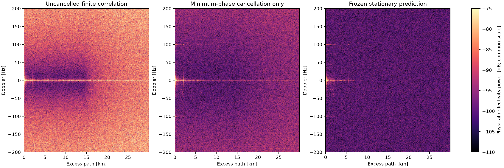
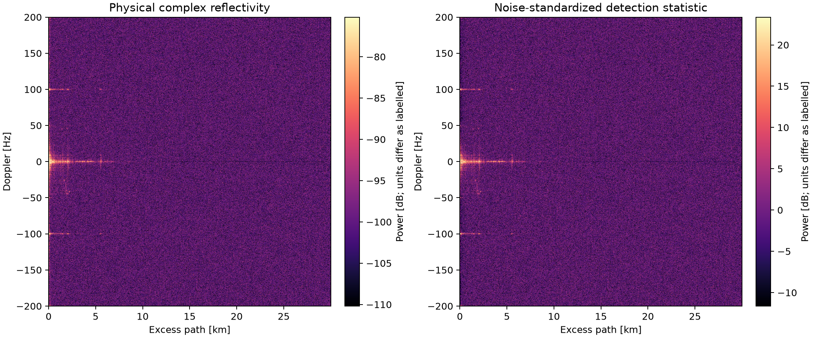
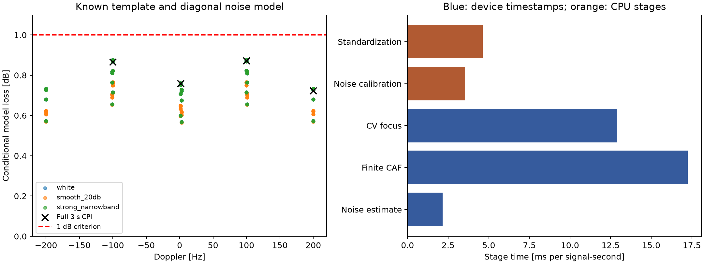

# Matched detection: improvements, bounds and validation

7 October 2026, updated after scheduling optimization. Default: a three-second CPI, 0–30 km excess path and ±200 Hz.
The accepted sensitivity benchmark excludes |Doppler| < 3/CPI and evaluates
constant **bistatic path rate**, including its range migration, over 0.6–30 km.

The production implementation is available through `MatchedDetector` and
`dvbt_detect`. It improves the waveform template, carrier-noise weighting,
stationary-background prediction and range migration. The original complex SAR
handoff remains available for image formation, and the legacy video processor
keeps its existing behavior.

The largest tested loss against the **specified diagonal-noise model** is
**0.877 dB**, including the model's guard-energy, clock and stationary-projection
allowances. Four complete three-second checks give 0.724–0.872 dB. Existing
frontend leakage adds approximately 0.006 dB; interpolation error is checked
separately. These results support approximately **0.89 dB in the tested model**.
They are sampled validation results, not a proof of a uniform bound for every
continuous range/Doppler coordinate or every possible impairment.

**The requested all-loss, real-recording 1 dB certificate is not established.**
Unknown waveform distortion, full temporal covariance and scene-dependent
leakage remain outside that model. Uniform-looking noise does not prove an
optimal detector. The implementation and evidence below avoid claiming that it
does. Repeated runtime comparisons show roughly 3–6% additional wall time and
lower active CPU use; device spans and host work are reported separately.

## What the earlier analysis missed

`echo_retention.png` measured attenuation of an injected echo when refitting the
minimum-phase response. It did not measure an SNR benefit. At order eight, the
earlier probe's largest loss above approximately 600 m and 1 Hz was 0.0011 dB.
The severe losses close to zero range and Doppler fall outside this benchmark.

The earlier ±0.8 dB band statistic averaged 31 windows. An individual three-second
map actually had an approximately **11.3 dB min–max range-median variation** across
Doppler. The visible bands were real. Pilot balancing alone did not fix them.

One occupied carrier, index 5840 (signed OFDM index 2432, adopted RF 560 MHz),
accounted for 41.1% of non-DC cross-spectrum power in the first diagnostic
excerpt. Its physical origin is unidentified. Differencing the physical
innovation removed this coherent tone and understated its noise contribution.
Differencing the **source-divided** innovation retains it because the QAM source
changes between symbols.

The corrected diagnostic weights lowered background by 2.42, 2.23 and 2.03 dB
for one-, three- and ten-second CPIs respectively. Those diagnostic weights
used the current batch; production uses earlier estimates, with a conservative
veto for a newly appearing strong blocker.

## The minimum-phase fit is still useful

The unchanged fit gives approximately 35–36 dB coherent direct-template
suppression in the original audit, and approximately 12.5 dB reduction in total
received power. Those are different quantities. They are not radar target SNRs.

A diagonal cross-spectrum with mean subtraction can hide the importance of
this cancellation. In the correct finite-waveform CAF, stationary residuals
produce random OFDM ambiguity energy at nonzero Doppler. For the first excerpt,
minimum-phase cancellation lowers the far, non-DC background by **9.66 dB**
relative to the otherwise identical uncancelled finite-correlation control.
Consequently I retained the order-eight fit. A trial extra per-symbol scalar
projection improved background by only 0.019 dB and was removed.

Optional stationary suppression now predicts the remaining stationary transfer
from at least three seconds of earlier data and freezes it. Every occupied
carrier must also have sufficient decoded source energy; known pilots alone
cannot complete calibration. No detection CPI
reuses its training observations, including decoder context. It adds a complex
multiply to an existing GPU pass and borrows existing response-fit statistics.
It does not introduce another FFT or become the hardware/template estimator.

This option deliberately suppresses **stationary multipath** as well as the
direct path. Moving returns in later data are not fitted. `--keep-dc` disables
both this prediction and the subsequent constant projection. The raw `SarBatch`
handoff is unchanged and retains stationary multipath for later scientific use.
Fading or changing stationary paths can leave residuals; the predictor is not
a guarantee of perfect cancellation in every scene.

| Excerpt | Additional median-background reduction from frozen prediction |
|---|---:|
| 57.844–60.844 s | 3.37 dB |
| 147.883–150.882 s | 3.58 dB |
| 272.842–275.841 s | 3.63 dB |

The first excerpt is **13.03 dB below the uncancelled control** in median
background over 0.6–29 km and |Doppler| ≥ 3/CPI. This is a calibrated physical
background comparison, not an injected-target SNR gain. The following plot
uses the same physical scale and exactly the same CPI in every panel.



## The implemented filter

The receive spectrum is weighted by `conj(Hmin)/D`, where `D` estimates physical
carrier-noise variance. Batch amplitude normalization exports its information
weight, `sum(|Hmin|²/D)/8192`, alongside the correlation profiles. Coherent
integration applies that weight and the corresponding weighted constant
projection. This preserves inverse-noise weighting when noise levels or channel
gain change between batches; normalizing each batch and averaging equally
would discard that information. The reconstructed source uses 9/16 weighting on boosted
pilots. The source reference before the guard comes from the previous symbol.
This supports excess delay beyond the guard without pretending the waveform
continues periodically across that boundary.

The implementation computes circular correlations and replaces the short prefix
where the reference belongs to the previous symbol. For delay `d`, integer FFT
origin `o` and guard length `g`, the correction covers `j < max(0,o+d-g)`:

```text
finite_CAF(d) = circular_CAF(d)
             + sum_j E(j) conj(S_previous(j-o-d+N+g) - S_current(j-o-d+N))
```

Fractional origin phase is applied before these operations. This identity is
exact for the reference convention used here. It replaces padded linear FFTs
with smaller circular FFTs and a bounded prefix calculation. The CPU test
computes the finite time-domain correlation independently.

Two correlation moments retain within-symbol Doppler:

```text
C0 = sum E(t) conj(S_delayed(t))
C1 = sum (t - useful_midpoint)/Tu * E(t) conj(S_delayed(t))
C(f) = C0 - j 2*pi*f*Tu*C1
```

At ±200 Hz, the ideal uniform-energy first-moment approximation loses 0.0162 dB
against the exact within-symbol exponential. The observation-space tests use
actual decoded symbols, not that uniform-energy approximation.

Constant path rate gives `Rdot = -c*fD/fRF`. The Fourier shear evaluates slow
time at `fD*(1+k*Fs/(1024*fRF))` for range-frequency index `k`. Physical
transmitter RF is used; channel NCO and receiver CFO are separate quantities.
The internal Doppler FFT is padded twofold; a 12-tap centered DFT interpolator
evaluates the fourfold output grid. Range is also sampled fourfold. Oversampling
reduces grid mismatch and does not improve physical resolution.

Per-channel histories, noise estimates, frozen predictions and FFT plans are
independent. They use the same original ADC/common-clock trajectory. No new
per-channel resampling is introduced. Maps export their physical RF, reference
origin and phase epoch at the CPI midpoint plus 4095.5/8 MHz. Channels with
different CPI epochs must be rephased to a common epoch before fusion.

## Window choice

For white noise and a known constant-path-rate template, rectangular weighting
is optimal. Hann loses

```text
10*log10(N*sum(w*w)/(sum(w)*sum(w))) = 1.761 dB
```

at fixed CPI. The [standard window reference](https://holometer.fnal.gov/GH_FFT.pdf)
also tabulates Hann’s equivalent noise bandwidth. Its lower sidelobes are a dynamic-range tradeoff. The new detector
uses no fixed taper after waveform-aware stationary subtraction, while retaining
inverse-noise temporal weights; the legacy
visualization retains Hann. A rectangular window cannot guarantee acceptable
leakage from arbitrary unresolved strong moving targets. Under an arbitrary
colored covariance, the optimum is a whitened matched filter, not a named taper.

Three seconds is a useful default, not a universal Pareto optimum. This stage
compensates Doppler-implied linear range migration. Acceleration, changing
bistatic projection and ISAR phase trajectories can still limit coherence.

## Why noise regularization is different from an SNR gain

The production carrier estimate removes common phase/timing-like modes **only
for estimating variance**. It does not subtract those modes from the receive
signal. Each carrier has bounded influence on that mode fit, so a very strong
narrow interferer cannot contaminate every quiet carrier's variance estimate.
Source-divided differences are converted back to physical variance,
combined in eight buckets and temporally smoothed. The earlier spectral shape
is adjusted by the robust median change in common noise level across carriers.
Each carrier's current estimate can raise its variance immediately, so a new
blocker is not underestimated. This also follows falling broadband noise
without slowly carrying an obsolete overall scale. A median-based floor limits
unstable inverse weights.
Stable source-divided time variance also catches slow interference on a fixed
pilot that adjacent differences can undercount. It replaces the difference
estimate only when more than twice as large; the independent fixed-pilot test
uses a 1.17 Hz interferer. No signal subtraction is performed by this check.

Map calibration estimates positive separable range and Doppler factors using
medians of separated resolution cells. The log estimates are shrunk toward a
common scale according to the sampling variance of an exponential-power median,
approximately `1/(N*log(2)^2)`. Strong deviations are retained. This avoids
introducing bands from uncertain scale estimates.

On the final three excerpts, physical range-median Doppler power is within
approximately **−0.36 to +0.39 dB for its central 90%**. Standardization adds
little further flattening because the filter has already removed the broad
bands. It supplies useful threshold units, not extra SNR. The factors are
stored with the complex map; scaling is positive, phase-preserving and reversible
to float precision. `--physical-units` retains physical complex amplitudes.

Independent known-noise tests, with 2% sparse bright-cell contamination, measure
0.015 dB RMS scale-shape error for white noise and 0.397 dB for smooth colored
noise. These use the known expected background, not a second fit to the same
noisy cells. They establish robustness for these controls, not a universal
false-alarm guarantee for impulsive interference.



## The theoretical optimum and what is proved

For `y=a*q+n`, known waveform `q`, positive-definite covariance `C` and linear
filter `w`,

```text
SNR(w) = |a|^2 * |w^H q|^2 / (w^H C w)
SNR_opt = |a|^2 * q^H C^-1 q
eta = |w^H q|^2 / [(w^H C w)*(q^H C^-1 q)] <= 1
```

Apply Cauchy–Schwarz to `C^(1/2)w` and `C^(-1/2)q`. Equality holds precisely
when `w` is proportional to `C^-1 q`. This proves the matched-filter bound and
provides an exact efficiency calculation for any specified `q,C,w`.

The independent numerical probe uses finite previous/current decoded waveforms,
fractional delay, within-symbol Doppler and Doppler-implied range migration.
It compares the implemented filter's adjoint with the exact signal in carrier
observation space, using the true covariance in the denominator. No noise
realizations or fitted output gains enter that calculation.

The 360-case sweep covers five delays, eight Dopplers, flat/recorded/synthetic
minimum-phase channels, and white/smooth-20-dB/strong-narrowband noise. Filter
variance estimates have independent 10% RMS log errors. It uses stratified
symbols over the three-second interval. Four additional checks use every one
of the 2,758 actual symbols in a full 3.000704-second CPI.

| Full-CPI check | Conditional loss, including listed allowances |
|---|---:|
| 800.125 samples, +100.0099 Hz; white noise, recorded response | 0.8724 dB |
| 16.125 samples, −100.0099 Hz; white noise, flat response | 0.8663 dB |
| 800.125 samples, +200 Hz; recorded diagonal noise and response | 0.7242 dB |
| 384.125 samples, +1.17 Hz; white noise, recorded response | 0.7585 dB |

The allowances are 0.2633 dB for omitted guard samples under the mean-energy
model, 0.0119 dB for the three-degree RMS phase budget, and approximately
0.0492 dB for constant projection outside |fD| ≥ 3/CPI. The guard term is not
an absolute per-waveform maximum, and the clock allowance is not a measured
certificate of the recording's physical clock error. The noise-estimation
error assumption is also a specified test condition.

The earlier frontend regression and 12-bit design mask imply approximately
0.006 dB blocker-leakage noise penalty. Numerical focusing tests show maximum
complex discrepancy below 4.6e-5 against direct backprojection, including
three-second VHF cases. Short-guard and long-guard correlation tests cover the
finite prefix correction, fractional origin and both moments.

The full-CPI direct-backprojection test also covers a 20 dB span of temporal
information weights, including the weighted stationary projection, with complex
error below 4.1e-5. Independent known-noise controls verify that inverse-variance
temporal combination attains the matched-filter information bound. Estimator
tests follow noise variance steps of 0.01 → 0.1 → 0.001 while retaining a narrow
interferer: carrier-median estimates are 0.00990, 0.10261 and 0.00102. Exported
ENBW includes the actual temporal weights rather than assuming a fixed rectangle.

These results qualify the tested retained-carrier model with GI 1/16. They do
not qualify every guard interval to the same energy budget: discarding a GI 1/4
already costs approximately 0.97 dB in the mean-energy white-noise model.



## Comparison with the previous filter

The [full-CPI comparison](data/detection_20261007/previous-filter-comparison.json)
uses the previous supported Hann operator with `slow-decimation=1`, its native
range/Doppler grid, circular current-symbol correlation, no carrier whitening
and no range migration. This avoids approximating its slow-time FIR. Its best
expected-SNR cell is selected over a generous neighborhood without using any
noise realizations. Thus the comparison favors the previous detector's peak,
rather than forcing it to the new filter's cell coordinates.

| Three-second case | Conditional SNR gain over previous filter |
|---|---:|
| 800.125 samples, +100.0099 Hz; white noise, recorded response | 7.02 dB |
| 16.125 samples, −100.0099 Hz; white noise, flat response | 6.56 dB |
| 800.125 samples, +200 Hz; recorded diagonal-noise proxy and response | 15.77 dB |
| 384.125 samples, +1.17 Hz; white noise, recorded response | 1.98 dB |

The slow case mainly illustrates the window/template gain. The faster cases
also gain from correcting the **approved Doppler-implied range migration** and
reducing grid mismatch. The large recorded-noise case includes suppression of
the strong narrow-carrier variance proxy. These are model results, not measured
target SNRs in an unlabeled scene; they do not establish a universal gain or a
full-covariance certificate. The new constant-projection allowance is retained
in the comparison. Shared guard and clock allowances cancel in the relative gain.

## Why the full real-data 1 dB claim remains open

Flat marginal noise powers do not bound correlations. For example, covariance
`[[1,rho],[rho,1]]` has exactly uniform marginal noise. With `q=(1,0)` and a
white-noise filter, efficiency is `1-rho^2`: at rho=0.6 the loss is 1.94 dB.
Thus an image with uniform background can still leave useful information in
correlated observations. Unknown covariance can make that gap arbitrarily large.

Nine-cell local covariance checks used separate range regions for training,
validation and evaluation. A same-region inverse suggests 0.13–0.54 dB local
oracle gains, but the selected regularized filters yield at most **0.017 dB**
on held-out regions and often lose sensitivity. The inverse estimate is also
finite-sample biased. I did not add an adaptive Doppler matrix filter without
repeatable benefit. This local test neither proves the full covariance diagonal
nor bounds the full observation-space optimum.

Unidentified temporal covariance, imperfect analog waveform knowledge,
nonlinear PA/receiver distortion, changing stationary paths and unresolved
moving-target sidelobes remain material uncertainties. Minimum phase alone
cannot distinguish hardware from every minimum-phase component of multipath.
The short fit and independent moving-echo tests limit demonstrated loss; they
do not solve that identifiability problem universally. The separate improvement
numbers above must not be added as independent target-SNR gains.

## Runtime and CPU/GPU ownership

The benchmark preloads 20 seconds of the 56 MS/s recording, warms for ten seconds,
then measures approximately 9.984 signal-seconds. It uses one channel, one FEC
worker, three bounded frame slots, a three-second CPI and one-second map updates.
File reads, file output, checksumming and video encoding are excluded. The
legacy run produces one additional final map. The new map has approximately
16 times as many cells because both axes are sampled fourfold.

The final numerical values and individual runs are saved in
[benchmark.json](data/detection_20261007/benchmark.json). Device timestamps,
active process CPU, active main-thread CPU and wall time are separate quantities;
they must not be added. Viterbi timings sum worker execution; this run has one
FEC worker. FFT plan preparation and frozen-background training are warmup costs.

The final serial repeats measure **100.43–102.44 ms/s new versus 94.23–102.64
ms/s legacy**. Their average difference is **3.1% extra wall time**, **6.4% less
active process CPU** and **38.7% less active main-thread CPU**. New active process
CPU is 89.07–89.50 ms/s; legacy is 93.38–97.36 ms/s. Main-thread CPU is
28.28–28.63 versus 44.35–48.49 ms/s. All runs have identical decoded packet
counts and checksum. The preceding asynchronous repeats measured 5.6% added
wall time. Baseline variability is substantial relative to that difference;
roughly **3–6%** is a more appropriate description than a precise overhead.
The new map still has approximately 16 times the cells.

The earlier synchronous implementation measured 115.61–129.62 ms/s and about
29% extra wall time. Those runs remain in the JSON. The main improvement is
scheduling: each channel may have one owned focusing job outstanding. The
receiver continues while that job focuses and calibrates the map. Borrowed
`SarBatch` spectra are still consumed synchronously; only copied correlation
profiles and immutable coordinates cross the worker boundary. Consumer callbacks,
error delivery and timing accumulation stay on the caller's thread. `finish()`
explicitly drains jobs at stream end and benchmark warmup boundaries.

Within-symbol gain is cached per grid rather than evaluated with transcendental
functions at every range cell. Extraction uses an 8×8 transpose for coalesced
reads and writes. Range IFFTs process 1,024 Doppler frequencies per batch rather
than 256, with 24 MiB additional bounded scratch per channel. A short-prefix FFT
convolution was numerically exact but gave no repeatable benefit, so it was
removed. Larger whole-symbol CAF batches also did not justify their memory cost;
the compact 128-symbol CAF tile remains. The new detector is the video tool's
default backend; the previous operator remains available for comparisons.

| New detector numerical stage | Runs on | Measured time, ms/s |
|---|---|---:|
| Common frontend/channelization/resampling | GPU | 15.1 |
| OFDM reception/synchronization/FFT/equalization | GPU, CPU tracking control | 4.9 GPU |
| Frame extraction | GPU | 3.1 |
| Hard demapping/deinterleaving | CPU | 7.8 |
| Viterbi | CPU worker | 31.9 |
| Reed–Solomon | CPU worker | 1.35 |
| Oracle reconstruction | GPU | 2.2 |
| Minimum-phase response/residual | GPU | 5.2 |
| Carrier-noise estimate | GPU, small CPU regularization | 2.1 GPU |
| Finite CAF and two Doppler moments | GPU | 17.2 |
| Constant-path-rate focusing | GPU worker | 12.9 |
| Robust map-noise calibration | CPU worker | 3.5 |
| Positive scalar standardization | CPU worker | 4.6 |

Calibration and standardization use the focusing worker's CPU clock. Overall
process/main-thread totals also use CPU clocks. Device values use Vulkan
timestamps. Worker CPU contributes to the process total and must not be added
a second time.

CPU/driver work, history copies and submission/waits are included in overall
wall/process/main CPU totals, not silently charged to device execution. The
legacy range IFFT, slow-time FIR and Hann Doppler FFT all run on the CPU. A
standalone legacy measurement gave 13.17 ms/s range IFFT, 11.16 ms/s slow filter
and 8.47 ms/map Hann FFT; it is not a like-for-like grid or focusing comparison.

## Run and reproduce

```sh
cmake --build --preset release --target dvbt_detect matched_tests -j8
export VK_DRIVER_FILES="$PWD/build/sdk/macOS/share/vulkan/icd.d/MoltenVK_icd.json"
# Enable validation for Debug checks:
export VK_LAYER_PATH="$PWD/build/sdk/macOS/share/vulkan/explicit_layer.d"
build/release/dvbt_detect \
  /Users/danielrd/data/dvbt_passive_radar/baseband_553000000Hz_12-51-54_26-09-2026.wav \
  --output build/detected-c31 --recording-rf-hz 553000000 \
  --channel 557625000,4625000,16 --start 50 --seconds 12 \
  --integration-seconds 3 --doppler-hz 200 --range-metres 30000
```

There is no real-time pacing. Acquisition, independent stationary training and
a complete CPI precede the first map. The final raw-I/Q trial emitted 10,812
decoded symbols and five maps. Repeat `--channel` for simultaneous channels.
`--map-stream FILE|-` writes framed complex maps; `--archive-maps` saves each map
instead of only `latest.rdm`. Logs go to stderr. Use `--physical-units` when
consuming physical complex amplitudes, and `--keep-dc` when retaining stationary
returns. Saved maps can be displayed by the existing viewer; processing
parameters for this backend are chosen on the CLI, not through legacy live
integration requests.

See [support-tool commands](../support/validation/README.md) and
[saved results and provenance](data/detection_20261007/README.md). Numerical
production classes contain no video encoding, browser controls or report code.

The complete Release suite passes 26 tests. Debug Vulkan validation covers the
new correlation/focusing kernels; the earlier broad Debug phase-regression run also
passes multichannel SAR and receiver/pipeline phase tests. Regression controls
include all three QAM constellations, an 80 dB magnitude span, frozen training
and reset, finite beyond-guard reconstruction, three-second VHF motion,
stationary projection, and reversible phase-preserving scalar calibration.
New async tests immediately overwrite every borrowed carrier/reference/validity
buffer after `append`, verify two channels' relative phase and common epoch,
require caller-thread delivery, and check drain, normalization and error handling.

## Saved validation

All 26 Release tests pass. Debug `matched_tests` passes with the Vulkan validation
layer explicitly enabled, including weighted focusing, finite-symbol boundary
correlation, fractional origins, phase epochs, independent channel phase,
owned asynchronous jobs, end-of-stream draining and exception propagation.
Ten independent Python sensitivity tests and seven video-support tests pass.
Compiler reports and generated assembly confirm automatic vectorization of
map scaling without intrinsics; median selection is intentionally scalar.
The raw-I/Q Debug CLI also produces a valid framed binary stream without library
diagnostics entering stdout. Full-recording video metadata checks are saved
with the render below.

## Full-recording video

The [finished QuickTime MOV](../renders/C31_3s_0-30km_pm200Hz_30p637fps_matched_dc_removed_20261007.mov)
covers the complete 301.84-second recording with the new detector: a 3.000704-second
coherent window, 0–30 km, ±200 Hz, stationary suppression and autoscaling. It uses
hardware ProRes 422, 10-bit Rec.709, independent frames and a front-loaded MOV
index. The 5.64 GB file has **9,248 frames at exactly 3125/102 ≈ 30.637 fps**;
its 301.85472-second duration is the recording rounded up to one video frame.
Rendering ran unpaced and took 991 seconds including all visualization and
encoding; that time is separate from the numerical pipeline benchmarks above.

All **9,027 detection maps** have a full three-second CPI, the correct physical
RF, phase epoch and inverse-noise window metadata. Their interval is exactly
30 OFDM symbols (0.03264 seconds), with no missing updates. The first complete
map ends at 7.172875 seconds after acquisition and independent stationary
training; the last ends at 301.781515 seconds. Acquisition is visibly labelled.
Training receive FFT windows do not overlap any detection CPI. Known decoded
previous-symbol reference context remains available for finite correlation.
The actual weighted ENBW varies from 0.33326 to 0.34009 Hz.

The full file decodes with no FFmpeg errors. All 9,248 packets are keyframes.
**34 AVFoundation distant, forward and reverse exact-frame seeks** return the
requested timestamps with zero error; median seek latency is 31 ms. This checks
the system playback framework, not QuickTime Player UI automation. Preview
frames at 60, 140 and 275 seconds were inspected for axes, overlays and data.
The [validation metrics](data/detection_20261007/video-validation.json),
[native seek results](data/detection_20261007/native-seeks.json) and
[render settings/timestamps](../renders/C31_3s_0-30km_pm200Hz_30p637fps_matched_dc_removed_20261007.json)
are saved.


### Fixed-colour revision

For consistent visual comparison, use the [fixed-colour MOV](../renders/C31_3s_0-30km_pm200Hz_30p637fps_matched_dc_removed_fixed_noise_floor_max_20261007.mov).
Every map uses **1.24–42.08 dB**. The displayed noise floor, estimated from
validated windows near 60, 150 and 275 seconds, is 2.74 dB: 1.5 dB above the
lower limit. The maximum over the complete recording is 41.83 dB, so the upper
limit leaves 0.25 dB headroom. No map clips at the upper limit. This replaces the
percentile contrast trial and does not adapt the colour scale between frames.

Timing, phase epochs and geometry match the previous video on all 9,027 maps.
The 9,248-frame ProRes movie retains 3125/102 fps and passes all 34 exact-frame
AVFoundation seeks. [Fit provenance](../renders/C31_3s_fixed_noise_floor_max_scale_20261007.json)
and [validation](../renders/C31_3s_0-30km_pm200Hz_30p637fps_matched_dc_removed_fixed_noise_floor_max_20261007.validation.json)
are saved beside the render.


